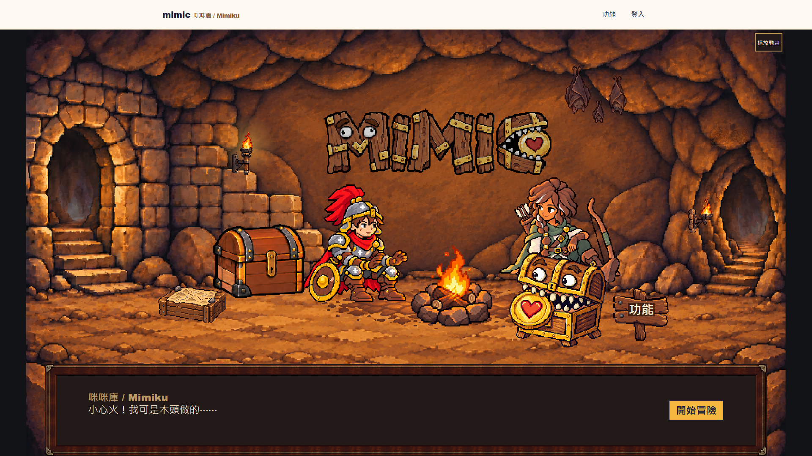
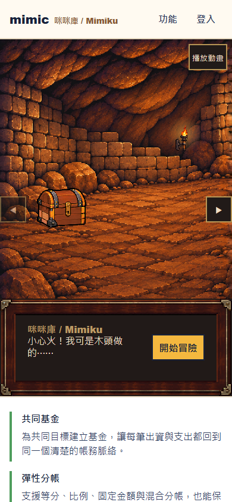

# Phase 2B Landing 視覺審核

日期為 2026-11-10。審閱項目為五句台詞、火把光暈與蝙蝠飛行、手機箭頭、木牌字樣和暫停鈕的位置。

- [截圖](screenshots/)涵蓋規格十種尺寸，每種有預設與互動後畫面。手機的開蓋寶箱和顯現壁畫位於不同 snap 段，另附左段開蓋圖；互動後主圖停在壁畫段，保留台詞與 CTA。
- [1920×1080 桌機錄影](videos/1920x1080-interactions.webm)與 [390×844 手機錄影](videos/390x844-interactions.webm)使用 Playwright 擷取，包含標題眨眼、篝火循環、蝙蝠飛離與返回、火把光暈、寶箱開合及壁畫淡入。

## 動態與可及性

| 動態 | 觸發 | 一般模式 | 減少動態 |
| --- | --- | --- | --- |
| 篝火 | 自動 | 四格循環，每格 166.66666666666666 ms。圖檔載入失敗時保留 Phase 2A 靜態篝火 | 第 0 格 |
| 標題 | 自動 | 隨機等待 8000–15000 ms 後播三格，90 ms、90 ms、90 ms，最後回到第 0 格 | 第 0 格 |
| 寶箱 | 操作 | 750 ms 開、660 ms 關。播放期間拒絕重複啟動，先完成寶箱再啟動排隊的壁畫 | 直接切換開／關結果 |
| 壁畫 | 操作 | 400 ms 交叉淡入，顯現維持到離頁。重按更新台詞 | 直接顯現 |
| 火把 | 操作 | 核准圖層後方的 CSS radial-gradient 在 600 ms 內變亮後回落 | 更新台詞 |
| 蝙蝠 | 操作 | 500 ms 整數邏輯像素步進上移，停留 1500 ms，500 ms 步進返回。按鈕留在原位 | 更新台詞 |
| 手機探索／木牌 | 操作 | 平滑移至相鄰 snap／`#features` | 即時捲動 |

篝火與標題共用依 elapsed time 和 `frame_ms` 選格的 `requestAnimationFrame` 播放器。頁面隱藏、場景離開視窗、暫停或即時切換至減少動態時，自動動態取消並重設第 0 格。暫停選項保存在可用的 localStorage 中，操作回饋仍可播放。

預設台詞呈現在伺服器輸出的對話行中，該行內的 polite live region 初始為空，互動時才接收台詞。行高空間預先保留。手機對話框垂直內距為 42 CSS px，以容納三行台詞並維持覆蓋位置，文字放大或超過安全區時沿用 Phase 2A 的流式排版。

## 核准時序

單元測試逐值核對 `restored-chest.config.mjs` 的兩組陣列與 `motion-timing.json` 的兩種場景各自的標題、篝火與標題間隔。瀏覽器測試另驗證寶箱逐格順序、總時長、播放鎖與壁畫排隊。

| 寶箱方向 | 順序及持續時間（ms） |
| --- | --- |
| 開 | latch-release 100 → unlatched 90 → cracked 150 → half-open 90 → opening-wide 70 → near-open 110 → open 140 |
| 關 | near-open 120 → opening-wide 100 → half-open 80 → cracked 70 → unlatched 90 → latch-release 80 → closed 120 |

## 命中區、焦點與手機 snap

按鈕由核准 layer 外框中心向外擴大到至少 44 CSS px。桌機寶箱命中框去掉上緣 30 邏輯 px（原始圖框為 y=160–340），和高火把外框底部 y=184 留下 6 邏輯 px。桌機 open 格的非透明範圍自圖框內 y=58 起，對應場景 y=218，與高火把焦點框分離。手機無須縮減物件命中框。

木牌文字獨立於場景 transform，四邊向內取整。米白文字 `#fff1d6` 疊在 72% 不透明度的深褐 CSS 字底 `rgb(37 20 11)`，用純白底圖估算保守對比下限，最亮混合背景為 `rgb(98 86 79)`。空間不足以容納兩個 12px 字時，保留具名連結並隱藏字樣。

手機箭頭為 44×44 CSS px，中心在場景 y=286。以四種手機寬度的左／中／右位置對照核准版面與擴大後的點擊區，共 192 次矩形交集檢查，與 Mimiku、角色臉部及互動物件均無交集。場景在 760 CSS px 起切換為桌機房間。手機從左到右的原生 snap markers 如下。

| 可視寬度（CSS px） | 左 | 中 | 右 | 初始 |
| --- | ---: | ---: | ---: | ---: |
| 360 | 0 | 414 | 810 | 414 |
| 375 | 0 | 399 | 795 | 399 |
| 390 | 0 | 390 | 780 | 390 |
| 430 | 0 | 390 | 740 | 390 |

CSS 首屏位移採同一公式。桌機只有單一房間與可視範圍。

木牌文字的保守對比下限為 6.35:1。黃金焦點框與外側深色描邊對比為 8.95:1。

### 十尺寸實測（CSS px）

| 視窗 | 寶箱 | 高火把 | 手機火把 | 蝙蝠 | 木牌 | 低火把 | 壁畫 | 木牌字級 |
| --- | --- | --- | --- | --- | --- | --- | --- | ---: |
| 768×1024 | 124.80×120.00 | 44.05×44.05 | — | 62.40×57.60 | 56.00×53.60 | 44.05×44.05 | 57.60×44.05 | 12.80 |
| 1280×720 | 187.78×180.56 | 44.05×66.20 | — | 93.89×86.67 | 84.26×80.65 | 44.05×52.96 | 86.67×57.78 | 19.26 |
| 1366×768 | 201.64×193.89 | 44.05×71.09 | — | 100.82×93.07 | 90.48×86.60 | 44.05×56.87 | 93.07×62.04 | 20.68 |
| 1440×900 | 234.00×225.00 | 44.04×82.50 | — | 117.00×108.00 | 105.00×100.50 | 46.50×66.00 | 108.00×72.00 | 24.00 |
| 1536×864 | 229.38×220.56 | 44.04×80.87 | — | 114.69×105.87 | 102.93×98.51 | 45.58×64.70 | 105.87×70.58 | 23.53 |
| 1920×1080 | 291.78×280.56 | 48.63×102.87 | — | 145.89×134.67 | 130.93×125.31 | 57.98×82.30 | 134.67×89.78 | 29.93 |
| 2560×1440 | 395.78×380.56 | 65.96×139.54 | — | 197.89×182.67 | 177.59×169.98 | 78.65×111.63 | 182.67×121.78 | 40.59 |
| 360×780 | 110.00×126.00 | — | 44.05×44.05 | 54.00×50.00 | 62.00×59.00 | — | 54.00×44.05 | 16.00 |
| 390×844 | 110.00×126.00 | — | 44.05×44.05 | 54.00×50.00 | 62.00×59.00 | — | 54.00×44.05 | 16.00 |
| 430×932 | 110.00×126.00 | — | 44.05×44.05 | 54.00×50.00 | 62.00×59.00 | — | 54.00×44.05 | 16.00 |

所有表內命中框皆通過兩兩無交集檢查。接近 44.05 px 的欄位代表依縮放向外補足最小尺寸，以保留瀏覽器次像素取整的餘裕。木牌字樣於表內尺寸均可顯示。

## 素材 SHA-256

下表共 18 項，每列的核准來源、manifest 與 runtime 實測 SHA-256 皆相同，disposition 為 `promoted-phase-2b`。執行 `npm run assets:promote` 共驗證 46 項。

| 核准及 runtime 相對路徑 | 共同 SHA-256 |
| --- | --- |
| `motion/campfire-desktop.png` | `5271a0d0312d96e4f905321ae74019d0f97aa34321651621ff38d0a933dd9e09` |
| `motion/campfire-phone.png` | `fe1f69e12e83dfd38d4b597497947d56d3fb96b31190731434c8102cc99698c6` |
| `props/landing/chest-cracked-desktop.png` | `b54f6fdc5c89112b148263f974fc2edfe7294b6e1f0f1fb7448f60caa7635fe4` |
| `props/landing/chest-cracked-phone.png` | `c864f6d5fa9e62840372260270d68aa5c9a7cf0257fee18cebe1f308f30dc747` |
| `props/landing/chest-half-open-desktop.png` | `8b2e3c155cc13335dabd97451eb9df316a53a8b0c3570276b6945daa95156ba7` |
| `props/landing/chest-half-open-phone.png` | `fac846b0e7796bd6d91246b53be5625221a8002789473958d44d54dbf9a42f23` |
| `props/landing/chest-latch-release-desktop.png` | `569af8fb2ea9b217411685ab39cdea4e1db788841583cd73b950821d9282dc98` |
| `props/landing/chest-latch-release-phone.png` | `c08fcede364ceb62ff72b3054cbc8925b8b7a873575812cc6766d2c37bbb4523` |
| `props/landing/chest-near-open-desktop.png` | `ccffc65ab9d4a9ea44f3abe377b00ba16efeb842cb7dadd5473aa465ac4119f7` |
| `props/landing/chest-near-open-phone.png` | `c6d2c82105c1778c36b7f9ec2a25dd11fcb609bc90d8c808fc7b478acb59084b` |
| `props/landing/chest-open-desktop.png` | `e18c938fe3f89e277419189344d9d9b356190c843d12cb5c044843e2f80dbce1` |
| `props/landing/chest-open-phone.png` | `bed440fb820f7491dba3c8ac624eebf419bbc242b1d2e32830ab7e74389a7de1` |
| `props/landing/chest-opening-wide-desktop.png` | `7a6d7be2c9f8dcefbecd60beacd42286476e99b76f6daf50aa8426c2342a9b40` |
| `props/landing/chest-opening-wide-phone.png` | `48afbe7a5daed12bb0fc94530ba19c79d9ffb5243003c6e78bffa113bf4ef953` |
| `props/landing/chest-unlatched-desktop.png` | `f9a7227dbdf89a3bda2abb3e6d6f8567bbb3659020b6cfe45124d2c7c04de05d` |
| `props/landing/chest-unlatched-phone.png` | `4c552640e4b10b6619d5a193f2015b8cfd7d1bb958f033f2f4eac276d708d127` |
| `props/landing/wall-carving-revealed-desktop.png` | `32e645f42cb747f61316ed5a02d741ab2af0b0540a94d3771300bc83c8e3e1e9` |
| `props/landing/wall-carving-revealed-phone.png` | `cd52162f95c2d851e9563f3ff9cbdbfd35e7a978107a44c725c8a78a470df4c9` |

## 首頁動態渲染與快取

乾淨基線的 Next.js build 列出 `○ /`（靜態）。候選版在 `(public)/page.tsx` 呼叫既有的 `hasSession()`，build 列出 `ƒ /`（按請求動態渲染），loopback 正式首頁回應 HTTP 200。初版在將首頁動態化後揭露兩個既有的根路由入口，正式首頁曾回應 500。移除重複的公開首頁 wrapper，讓 App Router 使用既有 `(public)` 版面與單一首頁入口後，正式版修復。

已登入 CTA 為「返回基地」→ `/app`，未登入為「開始冒險」→ `/register`。正式版 Playwright 以既有帳號 fixture 驗證登入狀態，確認 `mimic-public-pages` 已快取登入時的 HTML，以同源 CSRF 流程登出並確認 session cookie 已清除。登出後離線重載仍可能顯示已快取的「返回基地」，恢復連線重載時 `NetworkFirst` 取得最新 HTML，顯示「開始冒險」。

## 64f0173 基線比較

基線使用 `.tmp/phase-2b-baseline-lf` 的乾淨 detached worktree。工作樹維持 Git 內的 LF 位元組，以便比較歷史素材測試的固定雜湊。真實後端使用僅監聽 `127.0.0.1:3322` 的 API 與 `127.0.0.1:55443` 的專用 PostgreSQL。基線首跑有直接使用 Prisma 的測項因未提供 `DATABASE_URL` 嘗試預設埠並連線失敗。基線複驗和候選版完整測試均將 `DATABASE_URL` 與 `MIMIC_RUNTIME_DATABASE_URL` 指向專用 DB。

| 指令 | 64f0173 | Phase 2B | 分類 |
| --- | --- | --- | --- |
| `npm run lint` | 通過，2 則警告 | 通過，同 2 則警告 | 既有，兩個舊審閱 ESLint 設定的匿名預設匯出 |
| `npm run typecheck` | 通過 | 通過 | 最終版無差異 |
| `npm run test -- --maxWorkers=4 --testTimeout=60000` | 711 通過、21 失敗 | 717 通過、19 失敗 | 16 個失敗同一輪基線重現，另 3 個有基線或歷史重現，見下表 |
| `npm run build` | 通過，`○ /` | 通過，`ƒ /`，首頁 HTTP 200 | 動態渲染為本輪預期變更。初版 500 已修 |
| `npm run test:e2e`（正式版完整套件） | 首跑 435 通過、11 失敗、30 跳過。逐項複驗後 444 通過、2 失敗、30 跳過 | 首跑 458 通過、5 失敗、89 跳過。逐項複驗後 461 通過、2 失敗、89 跳過 | 2 個持續失敗均為既有手機審閱測項。跳過包含其他 Playwright 專案的重複矩陣與另行執行的錄影 |
| Phase 2B 指定 Playwright | — | 17 個功能測項與 2 個獨立錄影測項通過 | 本輪。另保留 10 個 Phase 2A Landing 回歸尺寸且全數通過 |

候選版完整 e2e 的三個 `phone-small` 財務測項在單 worker 複驗全數通過。基線初跑的 9 個財務失敗也在環境修正後通過。以下列出候選版首跑的全部 5 個 e2e 失敗。

| 測項 | 分類與複驗 |
| --- | --- |
| `navigation-home-tasks.real-backend.spec.ts` · 導覽、快速記帳與任務 | 基線亦出現間歇失敗，兩版複驗均通過 |
| `personal-expenses.runtime.spec.ts` · 個人寶箱記帳 | 並行首跑逾時，基線開發版曾重現，候選版單 worker 通過 |
| `real-backend-personal-references.spec.ts` · 私有分帳參考 | 候選版並行首跑逾時，單 worker 通過。基線修正 DB 環境後亦通過 |
| `avatar-classes-review.spec.ts:26` · `phone` | 既有。審閱頁寬度實測 390，期待值缺少 `phone` |
| `mimiku-states-actions-review.spec.ts:26` · `phone` | 既有。同一寬度期待值缺漏，基線與候選版均重現 |

### Vitest 失敗逐項

候選版失敗均出在歷史素材重建或完整性檢查。木牌定位審閱 HTML 在本輪開始前已有工作樹變更，該重建測試拒絕覆寫。歷史寶箱測試暫改的 sprite 與 manifest 已還原並與 `64f0173` Git blob 逐位元組核對。在隔離的 LF 候選工作樹以單 worker 重跑 `treasure-chest-states.test.ts`，9 項全數通過，包含完整套件的 3 個失敗案例。基線的歷史 Windows 素材回滾案例見 [Phase 2A 驗證](../2026-11-09-phase-2a/verification.md)。

| 測試檔 | 失敗案例 | 分類 |
| --- | --- | --- |
| `ancient-treasure-chest-v04.test.ts` | regenerates all51 PNG/HTML/manifest files byte-identically twice | 既有，同參數基線 |
| `ancient-treasure-chest-v04.test.ts` | rejects an incomplete output inventory before writing any output | 既有，同參數基線 |
| `ancient-treasure-chest.test.ts` | regenerates all51 PNG/HTML/manifest files byte-identically twice | 既有，同參數基線 |
| `ancient-treasure-chest.test.ts` | rejects an incomplete output inventory before writing any output | 既有，同參數基線 |
| `landing-prop-positioning.test.ts` | records every source/output hash and rebuilds byte-identically | 既有，同參數基線 |
| `pressure-plate-attempt-04-review.test.ts` | pressure plate v02 review only > keeps exact source history and the document's first prompt | 既有，同參數基線 |
| `pressure-plate-attempt-04-review.test.ts` | pressure plate v02 review only > rebuilds all review outputs byte-identically | 既有，同參數基線 |
| `pressure-plate-attempt-04-review.test.ts` | pressure plate v02 review only > refuses a modified output before writing any other target | 既有，同參數基線 |
| `pressure-plate-attempt-05-review.test.ts` | attempt-05 review integrity > rebuilds prepared guide, all PNGs, HTML and manifest byte-identically | 既有，同參數基線 |
| `pressure-plate-attempt-05-review.test.ts` | attempt-05 review integrity > refuses corrupt output without overwriting review files | 既有，同參數基線 |
| `pressure-plate-attempt-06-review.test.ts` | attempt-06 existing-source appearance review > pins all five existing raw sources, prompt chain, measured guide and extra colour references | 既有，同參數基線 |
| `pressure-plate-attempt-06-review.test.ts` | attempt-06 existing-source appearance review > rebuilds review outputs without rewriting existing measurement, guide or contracts | 既有，同參數基線 |
| `pressure-plate-attempt-06-review.test.ts` | attempt-06 existing-source appearance review > refuses a corrupt review output before overwriting the HTML | 既有，同參數基線 |
| `pressure-plate-v02.test.ts` | pressure plate v02 review only > rebuilds all review outputs byte-identically | 既有，同參數基線 |
| `pressure-plate-v02.test.ts` | pressure plate v02 review only > refuses a modified output before writing any other target | 既有，同參數基線 |
| `restored-treasure-chest.test.ts` | regenerates all51 PNG/HTML/manifest files byte-identically twice | 既有，同參數基線 |
| `treasure-chest-states.test.ts` | rebuilds all own PNG, HTML and manifest bytes identically twice | 既有，LF 基線初跑 |
| `treasure-chest-states.test.ts` | refuses changed own output before overwrite and restores only this test mutation | 既有，Phase 2A 回滾案例 |
| `treasure-chest-states.test.ts` | rejects an incomplete prior output inventory without writing outputs | 既有，LF 基線初跑 |

原始報告位於 `.tmp/phase-2b-loopback/baseline-lf-comparable-test.log`、`.tmp/phase-2b-full-unit-final.log`、`.tmp/phase-2b-loopback/baseline-production-e2e.json`、`.tmp/phase-2b-loopback/baseline-production-retry-e2e.json`、`.tmp/phase-2b-release-e2e.json`、`.tmp/phase-2b-release-e2e-retry.json` 、`.tmp/phase-2b-retry.json` 與 `.tmp/phase-2b-loopback/candidate-lf-treasure-chest-test.log`。

## 視覺審核

剩餘決策是台詞語氣、光暈與蝙蝠飛行的視覺力度、手機箭頭、木牌字樣和暫停鈕的位置。工作停在視覺審核。

## 2R 審閱修正

### 火把光暈

原本的偏心橢圓漸層沒有在四邊內完全淡出。2R 把光暈放在各支火把的前一個繪製層，使用普通 alpha 疊加。中心對齊核准火焰，暖橙為 `#ffb347`，峰值時中心 alpha 為 60%，半徑一半為 24%，到半徑終點為 0%。可見直徑為火把寬的三倍，外盒為四倍寬的正方形。手機以實際捲動位置限制半徑，於可視邊緣保留 2 CSS px，320 px 寬左段實測半徑 7.7 CSS px。所有焦點框仍在光暈之上。

在桌機非整數倍率下，整個光暈元素的 `opacity` 動畫會使畫面重新取樣，外圈即使沒有漸層也出現灰階差異。最後版本以數值型 CSS 自訂屬性直接動畫化各色標的 alpha，保留 600 ms 的亮起與回落。

### 蝙蝠路徑

飛出時往右上，每步約向上 4 邏輯 px，水平基準為垂直位移的一半，從第一步起依序交錯加 1、減 1 邏輯 px。所有 CSS transform 值均為整數邏輯 px，格間以 `steps(1, end)` 保持。桌機有 30 步，終點為 (59, −119)。手機有 27 步，終點為 (55, −107)。兩者均使整張圖的底緣越過場景上緣 1 邏輯 px。飛出、停留及沿原路返回分別為 500、1500、500 ms。

正式版 e2e 在 1920、390、320 px 檢查所有移動格都與 wordmark 和 Mimiku 外框分離、停留時整組已離開可視範圍、返程逐格等於出程的反序。減少動態時只更新原有台詞。

### 暫停鈕與審閱產物

舊版 `1920x1080-interacted.png` 是測試在 `reducedMotion: "reduce"` 下擷取的畫面。依 §6.2，此時隱藏暫停鈕是預期行為。2R 先驗證減少動態時隱藏，再切回一般動態並確認按鈕可見後截圖。[1920×1080 互動後截圖](screenshots-2r/1920x1080-interacted.png)

- [2R 十尺寸截圖](screenshots-2r/)
- [1920×1080 桌機互動錄影](videos-2r/1920x1080-interactions.webm)
- [390×844 手機互動錄影](videos-2r/390x844-interactions.webm)

### 峰值格與外圈灰階量測

完整互動錄影為有損 WebM。逐像素驗收改用相同正式版的 Chromium PNG screencast 記錄火把反應，無損編碼成 RGB VP9 WebM，再從短片解碼峰值格。解碼後的未觸發格與峰值格均逐位元組核對 RGB 擷取資料。樣本位於以實際火焰中心為圓心、離透明終點外 1 至 3 CSS px 的一圈，以 `round(0.299R + 0.587G + 0.114B)` 比較兩格的 8 位元灰階。火把量測期間先暫停篝火和標題，讓比較聚焦在火把反應。

| 視窗 | 圓心（CSS px） | 半徑（CSS px） | 未觸發格 → 峰值格 | 外圈取樣數 | 最大灰階差 | 超過 ±2 |
| --- | --- | ---: | --- | ---: | ---: | ---: |
| 1920x1080 | (584.30, 344.01) | 72.94 | 0 → 6 | 932 | 0 | 0 |
| 390x844 | (310.30, 225.00) | 30.00 | 0 → 12 | 394 | 0 | 0 |

[桌機無損取樣短片](videos-2r/1920x1080-torch-lossless.webm)

[手機無損取樣短片](videos-2r/390x844-torch-lossless.webm)

### 2R 驗證結果

- Landing 相關 Vitest 共 8 檔、87 項通過。Lint、typecheck、build 通過，lint 有兩則既有警告。
- 正式版 Playwright 僅跑 `landing-phase-2a`、`landing-phase-2b`、`pixel-responsive`、`public-and-auth`，63 項通過、93 項為跨專案重複矩陣的預期跳過。依 2R.4 排除使用真實後端的登入 fixture。2A 的方向鍵回歸先等右段 snap 完成再按左鍵，避免用捲動途中位置判斷。
- 原版 `screenshots/` 與 `videos/` 共 25 檔的 SHA-256 與 2R 前一致。2R 共 25 張 PNG（含兩張峰值格）和 4 段 WebM（兩段完整互動、兩段無損短片）。

最終原始報告為 `.tmp/phase-2b-2r-final-e2e.json` 與 `.tmp/phase-2b-2r-final-proof.log`。2R 停在視覺審核。
