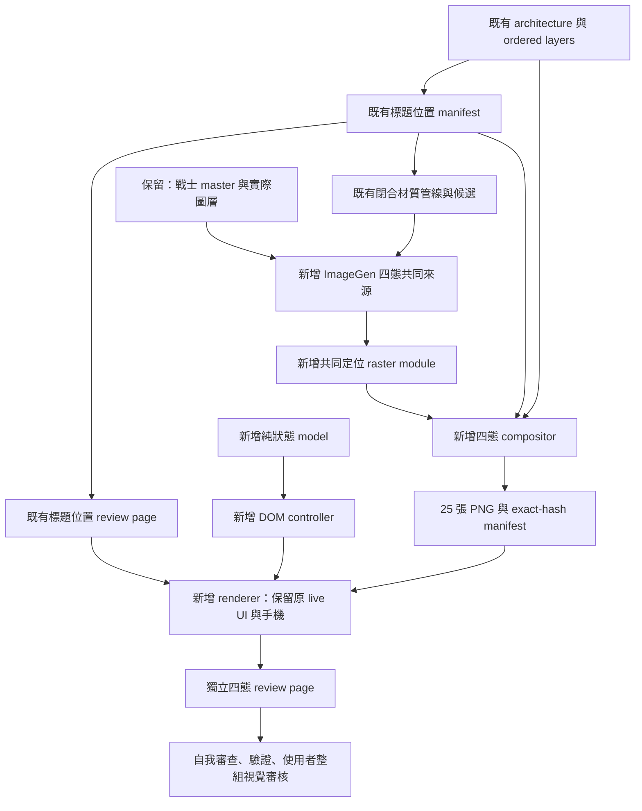

# Landing Treasure Chest States Implementation Plan

> **For agentic workers:** REQUIRED SUB-SKILL: Use `superpowers:executing-plans` to implement this plan task-by-task, inline in the current session. No worktree, subagents, or execution-mode question. Steps use checkbox syntax for tracking.

**Goal:** 將同一只圓拱木製藏寶箱完成為閉合、微開、半開、全開四態，放回固定桌機場景並提供可操作預覽，整組等待視覺審核。

**Architecture:** 保留既有標題位置、場景圖層順序、手機與材質比較管線。新管線從共同 ImageGen family source 產生共尺度、共 anchor 的四態 PNG，再從既有 architecture 與 ordered layers 重建場景；新 review page 的 live controls 只切換已驗證的輸出，不連接產品功能。

**Tech Stack:** Built-in ImageGen、Node ESM、既有 `pngjs`、Vitest、Playwright、原生 HTML buttons 與 inline JavaScript。

**Scope authority:** [已確認四態規格](../specs/2026-10-16-landing-treasure-chest-states-design.md)。本文件是實作計畫，不宣稱素材、程式或測試已完成。

## 1. 流程與責任：既有、保留、新增



現有呼叫路徑：`compose-landing-chest-material.mjs` 的 CLI 呼叫 `composeChestMaterial()`，讀取 `landing-title-placement.manifest.json`，以 `landing-chest-raster.mjs` 的 nearest/over/gray 合成，再呼叫 `render-landing-chest-material.mjs`。本輪**不執行、不修改**這個舊 composer；只唯讀重用 raster 的通用函式與既有場景資料。舊 `fitChest()` 逐張 fit 的方法不適用於動畫家族，不重用。

新增呼叫路徑：`compose-treasure-chest-states.mjs` → `prepareFamily()` → `renderTreasureChestReview(m,parentHTML,scripts)`；compositor 驗證原始 model/controller 的 SHA-256 後傳入原文，renderer 只移除 export 關鍵字並嵌入新頁，讓 `file://` 頁面不依賴 fetch 或 module script。不使用函式 toString，避免 Vitest 轉換插入分號造成非 deterministic 輸出。這不是新產品元件或新的產品狀態管理層。

## 2. 分支、依賴、交付單位

| 單位 | 分支 | 修改範圍 | 依賴 | 建議 commit message |
| --- | --- | --- | --- | --- |
| P：本計畫 | 沿用 `main`，不建分支/worktree | 僅本 Markdown | 已確認四態規格 | `docs(visual): plan treasure chest interaction states` |
| I：四態整組實作 | 沿用目前 checkout | 下列新增來源、管線、頁面、測試與 devlog 增量 | 使用者 review P 並手動 commit，或明確同意繼續 | `feat(visual): add coordinated treasure chest state review` |

新版協作約定優先：**agent 不執行 git add 或 git commit**。完成 P 後交付並暫停；I 是一個整組可審核的預定 commit 單位，內含 RED/GREEN 小步驟，不把尚未完成的單張素材先要求視覺核准。完成 I 後交付摘要、驗證證據、建議 commit message，暫停。手動 commit 不等於視覺核准，不自動推進其他道具或 Phase 2。

### 路徑縮寫

以下 `R/` 精確代表 `docs/design/assets/reviews/2026-09-18-page-visual-phase-1/`。程式中的 `prefix` 使用完整相同字串。

### 新檔案與責任

| Create | 責任 |
| --- | --- |
| `R/samples/derivations/treasure-chest-states-v01/family-source.png` | 原樣保留 ImageGen 2×2 四態透明 atlas |
| 同目錄 `prompt.md`、`lineage.json` | 實際 prompt、edit target、references、來源關係 |
| `R/treasure-chest-state.model.mjs` | 純狀態、140ms 計時、取消、載入失敗、reduced-motion |
| `R/treasure-chest-state.controller.mjs` | native buttons、decode、錯誤提示、場景圖片切換 |
| `R/treasure-chest-state.raster.mjs` | 單一尺度、固定 body/ground、共同 envelope |
| `R/render-treasure-chest-states.mjs` | 獨立 review HTML，不回寫舊頁 |
| `R/compose-treasure-chest-states.mjs` | 檢查來源、ordered reconstruction、輸出與 overwrite guards |
| `R/samples/treasure-chest-states-v01/*.png` | 25 張 deterministic review PNG，詳見 Task 5 |
| `R/treasure-chest-states.manifest.json` | 來源、尺寸、anchors、frames、exact SHA-256 |
| `R/treasure-chest-states-review.html` | 四態與場景、原候選、戰士、未改手機、live preview |
| `web/src/shared/brand/treasure-chest-state-model.test.ts` | 純互動模型 RED/GREEN |
| `web/src/shared/brand/treasure-chest-states.test.ts` | 真實來源與產物 contract、determinism、保護 guards |
| `web/e2e/treasure-chest-states-review.spec.ts` | 四 viewport 的實際瀏覽器 contract |
| `web/e2e/treasure-chest-states.playwright.config.ts` | 新 contract 加既有 120 個 browser regressions |

唯一既有檔案增量：實作完成後 append `.agents/devlog.md`。不改舊 specs、管線、HTML、manifest、tests、asset registry、`web/public`、runtime、PWA、service worker、產品頁面、Home 或帳務。

## 3. Task 1 — 基線與保護（實作前）

- [ ] 在 repo root 執行 `git status --short`，完整保留 staged/dirty/untracked，不 clean/reset/checkout；不讀寫 `.codex-remote-attachments/` 或 `reference/` 內容。
- [ ] 讀取 `AGENTS.md`、`.agents/features.md`、本計畫、四態規格及被其引用的材質規格。使用 executing-plans、TDD、imagegen；完成後 self-review、verification-before-completion。不得派遣 subagent。
- [ ] 執行下列唯讀基線命令，保存輸出到執行紀錄。既有圖片與 runtime 保護清單可存在 session memory；不得以 shell 重寫使用者檔案。

```powershell
node -e 'const fs=require("fs"),p=require("path"),c=require("crypto"),cp=require("child_process");const hash=b=>c.createHash("sha256").update(b).digest("hex");const scan=d=>fs.readdirSync(d,{withFileTypes:true}).flatMap(e=>{const f=p.join(d,e.name);return e.isDirectory()?scan(f):[[f.replaceAll("\\","/"),hash(fs.readFileSync(f))]];});const R="docs/design/assets/reviews/2026-09-18-page-visual-phase-1";console.log(JSON.stringify({status:cp.execFileSync("git",["status","--short"],{encoding:"utf8"}),index:hash(cp.execFileSync("git",["diff","--cached","--binary"],{maxBuffer:20000000})),protected:[...scan(R),...scan("web/public"),...scan("web/src/app"),...scan("web/src/features"),...scan("web/src/shared")],devlog:hash(fs.readFileSync(".agents/devlog.md"))},null,2));'
```

- [ ] 判讀此執行當下的基線，不硬套計畫撰寫時的 188 entries。保留 devlog 原始 bytes 以驗證 append prefix；新 test files 不在基線時不會被錯判為原檔修改。
- [ ] 檢查所有預計新路徑不存在；若已有本輪部分產物，先讀取與核對 provenance，不能直接覆蓋。若是其他人的同名工作，停止回報。

### 固定來源 pins

| 檔案（相對 R） | SHA-256 |
| --- | --- |
| `landing-title-placement.manifest.json` | `df90822ccb7fdd671899f08ec70c0d1535f16393d5b0ca4007aac0642d7eb1b5` |
| `landing-title-placement-review.html` | `da5a81e41a8b3f5bda76732ac6c611731d87f386819883816250b5542c515c71` |
| `landing-chest-material.manifest.json` | `c1e905b78299a1ae9f3c8d86b477a8ed368edc2ae9fce8eff6949abaf5946b18` |
| `samples/derivations/landing-chest-material-v01/ordinary-chest-source.png` | `b82139f77cb2cd10426caa1831f374eb9b65f85c0c5bb59deecdf9dd41ae1de9` |
| `samples/landing-chest-material-v01/ordinary-chest.png` | `fc2a8eb5b6337658e3056cc4cfc014328a4ec0c2920d800f9daa37451aef729b` |
| `samples/landing-chest-material-v01/desktop-logical.png` | `458e28654b436179472110fa97b904703e9dfa73cefc4cccd8bc077fa05a8c19` |
| `samples/avatar-classes/masters/warrior.png` | `cad8b04c066a149a081095ea7507091fd92fa65fdfd95ca9a40366cfcdbb9447` |
| `samples/landing-warm-rest/layers/A-desktop/warrior.png` | `fa155d31d7668e7d3660f89f4a90de865ca978abd725aa8bc5f591342eb252e1` |
| `samples/landing-title-placement-v01/desktop-single-logical.png` | `08dca5cb9f13c0a4ede1322f4e8f93295cae7b39a36438509a1286f12f87643f` |
| `samples/landing-title-placement-v01/phone-staggered-logical.png` | `dae2872edddfa14d68b37c7b5475c4680381db0826dc417cb8a07ee370385ecf` |

## 4. Task 2 — 互動模型先 RED，再 GREEN

- [ ] 先新增 `web/src/shared/brand/treasure-chest-state-model.test.ts`：

```ts
import {existsSync} from "node:fs";
import path from "node:path";
import {afterEach,expect,it,vi} from "vitest";
const file=path.resolve(process.cwd(),"../docs/design/assets/reviews/2026-09-18-page-visual-phase-1/treasure-chest-state.model.mjs");
type Snapshot={current:string;busy:boolean;error:string;ready:string[];canPlay:boolean};
type Model={snapshot:()=>Snapshot;available:(id:string,ok:boolean)=>void;select:(id:string)=>boolean;toggle:()=>boolean;dispose:()=>void};
type Factory=(o:{schedule:(fn:()=>void,ms:number)=>ReturnType<typeof setTimeout>;cancel:(id:ReturnType<typeof setTimeout>)=>void;onChange:(s:Snapshot)=>void;reducedMotion:()=>boolean})=>Model;
async function setup(reduced=false){
  expect(existsSync(file),"Chest state model required").toBe(true);
  const url=file.replaceAll("\\","/");
  const mod=await import(/* @vite-ignore */ url) as {createChestStateModel:Factory};
  vi.useFakeTimers();const trace:Snapshot[]=[];
  const m=mod.createChestStateModel({schedule:(f,ms)=>setTimeout(f,ms),cancel:clearTimeout,onChange:s=>trace.push(s),reducedMotion:()=>reduced});
  return {m,trace,ready:()=>["closed","cracked","half-open","open"].forEach(id=>m.available(id,true))};
}
afterEach(()=>{vi.clearAllTimers();vi.useRealTimers();});
it("does not autoplay or play before all frames decode",async()=>{
  const {m,ready}=await setup();expect(m.toggle()).toBe(false);ready();
  expect(m.snapshot()).toMatchObject({current:"closed",busy:false,canPlay:true});expect(vi.getTimerCount()).toBe(0);
});
it("opens and closes with three 140ms transitions without queuing",async()=>{
  const {m,ready}=await setup();ready();expect(m.toggle()).toBe(true);expect(m.toggle()).toBe(false);
  vi.advanceTimersByTime(139);expect(m.snapshot().current).toBe("closed");
  for(const id of ["cracked","half-open","open"]){vi.advanceTimersByTime(id==="cracked"?1:140);expect(m.snapshot().current).toBe(id);}
  expect(m.snapshot().busy).toBe(false);m.toggle();
  for(const id of ["half-open","cracked","closed"]){vi.advanceTimersByTime(140);expect(m.snapshot().current).toBe(id);}
  expect(vi.getTimerCount()).toBe(0);
});
it("manual frame selection cancels pending playback",async()=>{
  const {m,ready}=await setup();ready();m.toggle();vi.advanceTimersByTime(140);m.select("half-open");
  vi.advanceTimersByTime(1000);expect(m.snapshot()).toMatchObject({current:"half-open",busy:false});expect(vi.getTimerCount()).toBe(0);
});
it("reduced motion uses terminal frames but preserves manual inspection",async()=>{
  const {m,ready}=await setup(true);ready();m.toggle();expect(m.snapshot().current).toBe("open");
  expect(vi.getTimerCount()).toBe(0);m.select("cracked");expect(m.snapshot().current).toBe("cracked");
});
it("failure stops playback, rejects a failed frame and keeps other frames usable",async()=>{
  const {m,ready}=await setup();ready();m.toggle();m.available("open",false);vi.advanceTimersByTime(1000);
  expect(m.snapshot()).toMatchObject({current:"closed",busy:false,canPlay:false,error:"無法載入：open"});
  expect(m.select("open")).toBe(false);expect(m.select("half-open")).toBe(true);expect(vi.getTimerCount()).toBe(0);
  m.dispose();expect(vi.getTimerCount()).toBe(0);
});
```

- [ ] 從 `web/` 執行 `npm test -- src/shared/brand/treasure-chest-state-model.test.ts`。預期五個測試真正執行並因 `Chest state model required` 失敗；若 Vite 在收集前失敗，先修正 test loader，不能以零測試當 RED。
- [ ] 新增下列 model。當檔案存在後，把 test 的 URL variable import 改為 literal `import("../../../../docs/design/assets/reviews/2026-09-18-page-visual-phase-1/treasure-chest-state.model.mjs")`，移除不再使用的 `url`，避免 Windows 動態 URL 解析差異；不改任何斷言。

```js
export const states=["closed","cracked","half-open","open"];
export function createChestStateModel({schedule,cancel,onChange,reducedMotion}){
  let current=0,busy=false,timer=null,error="";
  const ready=new Set();
  const snapshot=()=>({current:states[current],busy,error,ready:[...ready],canPlay:ready.size===4&&!busy});
  const emit=()=>onChange(snapshot());
  const stop=()=>{if(timer!==null)cancel(timer);timer=null;busy=false;};
  function available(id,ok){
    if(!states.includes(id))throw Error("Unknown state");
    if(ok)ready.add(id);else{ready.delete(id);stop();error="無法載入："+id;}
    emit();
  }
  function select(id){
    const n=states.indexOf(id);if(n<0||!ready.has(id))return false;
    stop();current=n;emit();return true;
  }
  function toggle(){
    if(busy||ready.size!==4)return false;
    const target=current===3?0:3,direction=target>current?1:-1;
    if(reducedMotion()){current=target;emit();return true;}
    busy=true;emit();
    const tick=()=>{current+=direction;timer=null;if(current===target)busy=false;else timer=schedule(tick,140);emit();};
    timer=schedule(tick,140);return true;
  }
  emit();return {snapshot,available,select,toggle,dispose:stop};
}
```

- [ ] 重跑相同命令，預期五個 PASS；這只是 model GREEN，不是整組實作完成。

## 5. Task 3 — ImageGen 同一物件家族來源

- [ ] 完整閱讀 imagegen skill 及其必讀 reference。逐張 `view_image`：舊閉合 source、warrior master、實際 warrior layer、目前 desktop logical；檢查原材質、朝向、箱蓋、戰士顆粒與場景遮擋。不能只讀 hash。
- [ ] 使用 built-in ImageGen 編修四態 family，`transparent_background: true`，以四張實際檢視過的本地檔作 references；不要要求 CLI、SVG、canvas、程序繪製、CSS 旋轉代替創意稿。下面為完整起始提示，`prompt.md` 必須記錄**實際送出的版本**及所有後續 edit prompts：

```text
Edit the ordinary round-arched wooden treasure chest in reference 1 into ONE coordinated pixel-art sprite family. References 2 and 3 are the approved warrior pixel/material benchmark; reference 4 is the unchanged landing room for scale and warm campfire context. Do not redesign the room, character, or title.

Deliver ONE transparent 2-by-2 atlas with four equal cells: top-left closed, top-right cracked, bottom-left half-open, bottom-right fully open. No captions, borders, background, floor, shadows outside the chest, or UI. Leave transparent margins on every edge of each cell. All four cells have IDENTICAL chest-body dimensions, ground baseline, horizontal center, perspective, iron-band and lock-plate identity, and hinge position. Provide substantial identical empty headroom above each chest for the raised lid. Do not independently enlarge or fit each state. This is the SAME physical chest, not four alternatives.

Preserve the round wooden arched lid, dark stepped outline, muted warm dark-gray iron bands, lock plate, and existing three-quarter facing. Only rotate the lid around a believable attached hinge and reveal the inner wood and contents as occlusion changes. The closed chest shows no contents. Cracked shows only a small warm reflection through the narrow gap, not emitted light. Half-open partially reveals gold coins and a few small gems. Fully open retains all treasure within the chest rim: overlapping readable gold coin clusters are dominant, a few restrained gems secondary. No treasure on the ground, flying coins, currency symbols, reward burst, separate glow, light beam, sparks, particles, face, teeth, or mimiku traits.

Use the warrior's deliberate fine pixel clusters, dark brown-black stepped contours, two or three material tones, broken highlights, sparse clear wood grain, modest wear, handmade asymmetry. Avoid smooth vector curves, blur, gradients, photoreal lighting, noisy stippling, heavy corrosion, plastic mobile-game gloss, or tiny incoherent AI ornament. Body and feet must remain pixel-consistent between cells; the bottom portion is deliberately unobstructed in every state. Closed silhouette should fit the established 78 by 66 logical-pixel footprint; taller open lids expand upward into shared headroom, never scale down the body. The chest remains a secondary warm-room prop, not brighter or more prominent than the campfire and companions.
```

- [ ] Inspect actual generated atlas with `view_image` before processing. 2×2 cells必須等尺寸、各自有透明留白；若箱身、朝向或尺度漂移，修訂同一家族來源，不進行獨立 warp/fit。若104×120候選包絡不足，先回報具體超界／遮擋；不能自行縮小箱身或移動其他道具。
- [ ] 將實際生成檔 byte-for-byte 複製至新 `family-source.png`；確認複製前後 SHA 一致。保存失敗候選到新 revision，不覆寫舊材質 source。不得預填尚不存在的生成 hash。
- [ ] 透過 apply_patch 新增實際 `prompt.md` 與以下 `lineage.json`，結構與相對 repo 路徑精確一致。四態共用一張 atlas來源，manifest 另記各自 cell rect，不假裝有四次獨立生成。

```json
{
  "schema": "mimic-treasure-chest-family/v1",
  "generator": "imagegen",
  "transparent": true,
  "path": "docs/design/assets/reviews/2026-09-18-page-visual-phase-1/samples/derivations/treasure-chest-states-v01/family-source.png",
  "parentPath": "docs/design/assets/reviews/2026-09-18-page-visual-phase-1/samples/derivations/landing-chest-material-v01/ordinary-chest-source.png",
  "promptPath": "docs/design/assets/reviews/2026-09-18-page-visual-phase-1/samples/derivations/treasure-chest-states-v01/prompt.md",
  "references": [
    "docs/design/assets/reviews/2026-09-18-page-visual-phase-1/samples/avatar-classes/masters/warrior.png",
    "docs/design/assets/reviews/2026-09-18-page-visual-phase-1/samples/landing-warm-rest/layers/A-desktop/warrior.png",
    "docs/design/assets/reviews/2026-09-18-page-visual-phase-1/samples/landing-chest-material-v01/desktop-logical.png"
  ],
  "cells": ["closed", "cracked", "half-open", "open"]
}
```

## 6. Task 4 — 共用定位 raster（先 contract RED）

技術起始包絡：104×120；場景原點(92,230)，local ground(52,120)，world ground(144,350)。舊閉合 footprint 位於 local(13,54,78,66)。這不是新的寶箱位置決策。箱蓋只能往共同留白延伸；不得把打開狀態重新 fit 回78×66。

固定箱身下部採 closed 的最後30列 ImageGen pixels 重用；先檢查其他態對應 band 的位置、寬度與下緣，再共用，不拿此步驟掩蓋不同透視。接縫與鉸鏈必須人工檢查。manifest 的 hingeReference 是待人工核對的 review guide，不能聲稱為自動測量的物理鉸鏈。

- [ ] 在 Task 7 的 artifact test 中先加入 `common envelope, body and source transforms` 測試並執行，確定因 manifest/output 尚不存在而 RED。
- [ ] 新增 `R/treasure-chest-state.raster.mjs`：

```js
import {createRequire} from "node:module";
import path from "node:path";
import {fileURLToPath} from "node:url";
import {bounds,nearest} from "./landing-chest-raster.mjs";
const repo=path.resolve(path.dirname(fileURLToPath(import.meta.url)),"../../../../..");
const {PNG}=createRequire(path.join(repo,"web/package.json"))("pngjs");
export const layout={width:104,height:120,sceneOrigin:[92,230],ground:[52,120],worldGround:[144,350],closedFootprint:[13,54,78,66],bodyStart:90,hingeReference:{kind:"review-guide",point:[52,84]}};
export function prepareFamily(atlas){
  if(atlas.width%2||atlas.height%2)throw Error("Even 2x2 atlas required");
  const cw=atlas.width/2,ch=atlas.height/2;
  const cells=[0,1,2,3].map(i=>({x:(i%2)*cw,y:Math.floor(i/2)*ch,width:cw,height:ch}));
  const raw=cells.map(c=>nearest(atlas,cw,ch,c));
  const boxes=raw.map(p=>bounds(p));
  for(const b of boxes)if(b.x===0||b.y===0||b.x+b.width===cw||b.y+b.height===ch)throw Error("Source touches cell edge");
  const b=boxes[0],scale=Math.min(78/b.width,66/b.height),anchor=[b.x+b.width/2,b.y+b.height];
  if(Math.round(b.width*scale)<74||Math.round(b.height*scale)<62)throw Error("Closed proportions mismatch");
  const sprites=raw.map(p=>{
    const out=new PNG({width:104,height:120});
    for(let y=0;y<120;y++)for(let x=0;x<104;x++){
      const sx=Math.floor(anchor[0]+(x-52)/scale),sy=Math.floor(anchor[1]+(y-120)/scale);
      if(sx<0||sy<0||sx>=cw||sy>=ch)continue;
      const si=(sy*cw+sx)*4,di=(y*104+x)*4;
      if(p.data[si+3]<200)continue;
      out.data.set(p.data.subarray(si,si+3),di);out.data[di+3]=255;
    }
    return out;
  });
  for(const box of boxes){
    const left=52+(box.x-anchor[0])*scale,top=120+(box.y-anchor[1])*scale;
    if(left<1||top<1||left+box.width*scale>103||top+box.height*scale>120.5)throw Error("Family exceeds common envelope");
  }
  const bands=sprites.map(p=>bounds(nearest(p,104,30,{x:0,y:90,width:104,height:30})));
  for(const q of bands){
    const p=bands[0];
    if(Math.abs(q.x-p.x)>2||Math.abs(q.width-p.width)>4||Math.abs(q.y+q.height-p.y-p.height)>2)throw Error("Body registration mismatch: revise ImageGen family");
  }
  for(const p of sprites.slice(1))sprites[0].data.copy(p.data,90*104*4,90*104*4);
  return {sprites,registration:{cells,boxes,scale,rawAnchor:anchor,rawBodyBands:bands,bodyReuse:{from:"closed",startRow:90}}};
}
```

- [ ] 不能把測試通過等同風格一致。若共用下部與上部接縫不自然、鐵帶斷掉或 body 跟蓋的鉸鏈不合理，回 ImageGen 修整來源；不移動箱身或放寬 guard 讓錯稿通過。

## 7. Task 5 — 獨立 compositor 與完整輸出

- [ ] 先建立 Task 7 的 artifact contracts，執行並確認真實 RED；不得先製作 manifest 假資料當 GREEN。
- [ ] 新增 `R/compose-treasure-chest-states.mjs`。此 CLI 只寫新家族路徑；import 不自動寫入。`outputs` 固定25張：無寶箱背景1張，每態 sprite、sprite-gray、2x、logical、color、gray 各6張。四態顏色 scene1920×1080由960×540 nearest2x輸出。

```js
import {createHash} from "node:crypto";
import {readFile,writeFile,mkdir} from "node:fs/promises";
import path from "node:path";
import {fileURLToPath} from "node:url";
import {createRequire} from "node:module";
import {isDeepStrictEqual as equal} from "node:util";
import {nearest,over,gray} from "./landing-chest-raster.mjs";
import {prepareFamily,layout} from "./treasure-chest-state.raster.mjs";
import {states} from "./treasure-chest-state.model.mjs";
import {renderTreasureChestReview} from "./render-treasure-chest-states.mjs";
const dir=path.dirname(fileURLToPath(import.meta.url)),repo=path.resolve(dir,"../../../../..");
const {PNG}=createRequire(path.join(repo,"web/package.json"))("pngjs");
const prefix="docs/design/assets/reviews/2026-09-18-page-visual-phase-1/";
const hash=b=>createHash("sha256").update(b).digest("hex");
const relative=f=>path.relative(repo,f).replaceAll("\\","/");
async function bytes(a){
  const f=path.resolve(repo,a.path);
  if(!f.startsWith(dir+path.sep))throw Error("Input outside review");
  const b=await readFile(f);if(hash(b)!==a.sha256)throw Error("Changed input: "+a.path);return b;
}
async function png(a){
  const p=PNG.sync.read(await bytes(a));
  if(p.width!==a.width||p.height!==a.height)throw Error("Changed dimensions");return p;
}
async function record(name,raster=false){
  const file=path.join(dir,name),b=await readFile(file),a={path:relative(file),sha256:hash(b)};
  if(!raster)return a;
  const p=PNG.sync.read(b);return {...a,width:p.width,height:p.height};
}
async function build(parent,replacement){
  const a=await png(parent.sources.architectureDesktop),ratio=960/540;
  const cw=a.width/a.height>ratio?Math.round(a.height*ratio):a.width;
  const ch=a.width/a.height>ratio?a.height:Math.round(a.width/ratio);
  const out=nearest(a,960,540,{x:Math.floor((a.width-cw)/2),y:Math.floor((a.height-ch)/2),width:cw,height:ch});
  for(let i=3;i<out.data.length;i+=4)out.data[i]=255;
  for(const l of parent.scenes.desktop.layers){
    if(l.id!=="chest"||replacement===undefined)over(out,await png(l),l.x,l.y);
    else if(replacement!==null)over(out,replacement,...layout.sceneOrigin);
  }
  const t=parent.frames["desktop-single"].title;over(out,await png(t),t.x,t.y);return out;
}
export async function composeTreasureChestStates(){
  const parentRecord={path:prefix+"landing-title-placement.manifest.json",sha256:"df90822ccb7fdd671899f08ec70c0d1535f16393d5b0ca4007aac0642d7eb1b5"};
  const materialRecord={path:prefix+"landing-chest-material.manifest.json",sha256:"c1e905b78299a1ae9f3c8d86b477a8ed368edc2ae9fce8eff6949abaf5946b18"};
  const parent=JSON.parse((await bytes(parentRecord)).toString()),material=JSON.parse((await bytes(materialRecord)).toString());
  const before=parent.frames["desktop-single"],phone=parent.frames["phone-staggered"],chest=parent.scenes.desktop.layers.find(l=>l.id==="chest");
  if(!equal([before.title.x,before.title.y,before.title.width,before.title.height],[376,100,288,84])||
     !equal([phone.title.x,phone.title.y,phone.title.width,phone.title.height],[130,59,148,98])||
     !chest||!equal([chest.x,chest.y,chest.width,chest.height],[105,284,78,66]))throw Error("Frozen geometry mismatch");
  const sourceDir="samples/derivations/treasure-chest-states-v01/";
  const inputs={parent:parentRecord,material:materialRecord,
    source:await record(sourceDir+"family-source.png",true),prompt:await record(sourceDir+"prompt.md"),lineage:await record(sourceDir+"lineage.json"),
    closedSource:material.inputs.source,closedLayer:material.outputs.layer,
    warriorMaster:material.inputs.warriorMaster,warriorLayer:material.inputs.warriorLayer,referenceScene:material.outputs.logical,
    parentReview:await record("landing-title-placement-review.html"),
    composer:await record("compose-treasure-chest-states.mjs"),renderer:await record("render-treasure-chest-states.mjs"),
    raster:await record("treasure-chest-state.raster.mjs"),model:await record("treasure-chest-state.model.mjs"),controller:await record("treasure-chest-state.controller.mjs"),
    sharedRaster:await record("landing-chest-raster.mjs")};
  if(inputs.parentReview.sha256!=="da5a81e41a8b3f5bda76732ac6c611731d87f386819883816250b5542c515c71")throw Error("Parent review changed");
  for(const a of [inputs.closedSource,inputs.closedLayer,inputs.warriorMaster,inputs.warriorLayer,inputs.referenceScene])await png(a);
  for(const a of [phone.logical,phone.color,phone.gray,phone.title,before.title])await png(a);
  if(phone.logical.sha256!=="dae2872edddfa14d68b37c7b5475c4680381db0826dc417cb8a07ee370385ecf")throw Error("Frozen phone changed");
  const lineage=JSON.parse((await bytes(inputs.lineage)).toString());
  if(!equal(lineage,{schema:"mimic-treasure-chest-family/v1",generator:"imagegen",transparent:true,path:inputs.source.path,
    parentPath:inputs.closedSource.path,promptPath:inputs.prompt.path,references:[inputs.warriorMaster.path,inputs.warriorLayer.path,inputs.referenceScene.path],cells:states}))throw Error("Invalid ImageGen lineage");
  const attempt1=await record(sourceDir+"family-source-attempt-01.png",true),attempt2=await record(sourceDir+"family-source-attempt-02.png",true);
  const sourceHistory=[
    {source:attempt1,editTarget:inputs.closedSource,references:[inputs.warriorMaster,inputs.warriorLayer,inputs.referenceScene]},
    {source:attempt2,editTarget:attempt1,references:[]},
    {source:inputs.source,editTarget:attempt2,references:[]},
  ];
  await png(attempt1);await png(attempt2);
  const original=await build(parent),baseline=await png(before.logical);
  if(!original.data.equals(baseline.data))throw Error("Old reconstruction mismatch");
  const atlas=await png(inputs.source);
  if(!atlas.data.some((v,i)=>i%4===3&&v===0))throw Error("Transparent source required");
  const family=prepareFamily(atlas),writes=new Map(),outputs={},frames={};
  const save=(name,p)=>{
    const file=path.join(dir,"samples/treasure-chest-states-v01",name+".png"),b=PNG.sync.write(p);
    writes.set(file,b);const a={path:relative(file),sha256:hash(b),width:p.width,height:p.height};outputs[name]=a;return a;
  };
  const backdrop=save("desktop-without-chest",await build(parent,null));
  for(const [i,id] of states.entries()){
    const sprite=family.sprites[i],logical=await build(parent,sprite);let changed=0;
    for(let y=0;y<540;y++)for(let x=0;x<960;x++){
      const n=(y*960+x)*4;if(logical.data.subarray(n,n+4).equals(baseline.data.subarray(n,n+4)))continue;
      if(x<92||x>=196||y<230||y>=350)throw Error("Changed pixels outside chest envelope");changed++;
    }
    if(!changed)throw Error("No visible chest change");
    const color=nearest(logical,1920,1080);
    frames[id]={source:{...inputs.source,cell:family.registration.cells[i]},canvas:[104,120],sceneOrigin:layout.sceneOrigin,
      ground:layout.ground,worldGround:layout.worldGround,hingeReference:layout.hingeReference,title:before.title,changedPixels:changed,
      sprite:save(id+"-sprite",sprite),spriteGray:save(id+"-sprite-gray",gray(sprite)),zoom:save(id+"-2x",nearest(sprite,208,240)),
      logical:save(id+"-logical",logical),color:save(id+"-color",color),gray:save(id+"-gray",gray(color))};
  }
  const m={schema:"mimic-treasure-chest-states/v1",decision:"awaiting-calibration",reviewOnly:true,runtimePromotion:false,
    spec:"docs/superpowers/specs/2026-10-16-landing-treasure-chest-states-design.md",
    plan:"docs/superpowers/plans/2026-10-16-landing-treasure-chest-states.md",inputs,layout,registration:family.registration,
    backdrop,outputs,frames,parentDesktop:before,phone,sourceHistory};
  const scripts={model:(await bytes(inputs.model)).toString(),controller:(await bytes(inputs.controller)).toString()};
  const html=renderTreasureChestReview(m,(await bytes(inputs.parentReview)).toString(),scripts);
  const htmlFile=path.join(dir,"treasure-chest-states-review.html"),manifestFile=path.join(dir,"treasure-chest-states.manifest.json");
  const complete={...m,review:{path:relative(htmlFile),sha256:hash(html)}};writes.set(htmlFile,Buffer.from(html));
  let previous;
  try{previous=JSON.parse(await readFile(manifestFile,"utf8"));}catch(e){if(e.code!=="ENOENT")throw e;}
  if(previous){
    if(!equal(Object.keys(previous.outputs??{}).sort(),Object.keys(outputs).sort())||previous.review?.path!==relative(htmlFile))throw Error("Existing output set differs");
    const stable=v=>Object.fromEntries(Object.entries(v).filter(([k])=>!["composer","renderer","raster","model","controller"].includes(k)));
    if(!equal(stable(previous.inputs),stable(inputs)))throw Error("Existing provenance differs");
    if(previous.sourceHistory&&!equal(previous.sourceHistory,sourceHistory))throw Error("Existing source history differs");
    for(const a of [...Object.values(previous.outputs),previous.review]){
      if(!writes.has(path.resolve(repo,a.path)))throw Error("Unexpected existing target");await bytes(a);
    }
  }else{
    for(const f of writes.keys())try{await readFile(f);throw Error("Unexpected existing output");}catch(e){if(e.code!=="ENOENT")throw e;}
  }
  for(const [f,b] of writes){await mkdir(path.dirname(f),{recursive:true});await writeFile(f,b);}
  await writeFile(manifestFile,JSON.stringify(complete,null,2)+"\n");return complete;
}
if(process.argv[1]&&path.resolve(process.argv[1])===fileURLToPath(import.meta.url))console.log(JSON.stringify(await composeTreasureChestStates(),null,2));
```

## 8. Task 6 — renderer 與 native interaction controller

- [ ] 先建立 Task 8 的 Playwright cases，執行單一新 spec，預期因新頁不存在失敗；再新增下列兩個模組。這個 RED 不取代 model 與 raster 的 RED。
- [ ] 新增 `R/treasure-chest-state.controller.mjs`：

```js
export async function mountChestStates(factory,root=document){
  const host=root.querySelector("[data-chest-preview]"),img=host?.querySelector(".scene picture img");
  if(!host||!img)return;
  const picks=[...host.querySelectorAll("[data-pick]")],plays=[...host.querySelectorAll("[data-toggle]")];
  const assets=[...host.querySelectorAll("[data-state-asset]")];
  const status=host.querySelector("[data-current]"),error=host.querySelector("[data-error]");
  const model=factory({schedule:(fn,ms)=>setTimeout(fn,ms),cancel:id=>clearTimeout(id),
    reducedMotion:()=>matchMedia("(prefers-reduced-motion: reduce)").matches,
    onChange:s=>{
      host.dataset.state=s.current;host.dataset.busy=String(s.busy);status.textContent=s.current;error.textContent=s.error;
      const a=assets.find(a=>a.dataset.stateAsset===s.current);
      if(a&&s.ready.includes(s.current))img.src=a.src;
      for(const b of picks){b.disabled=!s.ready.includes(b.dataset.pick);b.setAttribute("aria-pressed",String(b.dataset.pick===s.current));}
      for(const b of plays){b.disabled=!s.canPlay;b.setAttribute("aria-label",s.current==="open"?"關閉藏寶箱":"開啟藏寶箱");}
    }});
  for(const b of picks)b.addEventListener("click",()=>model.select(b.dataset.pick));
  for(const b of plays)b.addEventListener("click",()=>model.toggle());
  await Promise.all(assets.map(async a=>{
    let failed=false;const fail=()=>{failed=true;model.available(a.dataset.stateAsset,false);};
    a.addEventListener("error",fail);
    try{await a.decode();if(!failed)model.available(a.dataset.stateAsset,true);}catch{fail();}
  }));
  host.dataset.loaded="true";return model;
}
```

- [ ] 新增 `R/render-treasure-chest-states.mjs`：

```js
import {states} from "./treasure-chest-state.model.mjs";
const prefix="docs/design/assets/reviews/2026-09-18-page-visual-phase-1/";
const rel=a=>a.path.slice(prefix.length);
const esc=s=>String(s).replaceAll("&","&amp;").replaceAll("<","&lt;").replaceAll(">","&gt;").replaceAll('"',"&quot;");
export function renderTreasureChestReview(m,parentHTML,scripts){
  const end=parentHTML.indexOf("</head>");if(end<0)throw Error("Missing parent head");
  const head=parentHTML.slice(0,end).replace(/<title>[^<]*<\/title>/,"<title>Landing — 藏寶箱四態比較</title>");
  let desktop=parentHTML.match(/<section class="candidate" data-candidate="desktop-single">[\s\S]*?<\/section>/)?.[0];
  const phone=parentHTML.match(/<section><h2>手機：共用交錯兩行版<\/h2>[\s\S]*?<\/section>/)?.[0];
  const j=parentHTML.indexOf('<div class="journal" id="journal">'),n=parentHTML.indexOf('<section class="notes"',j);
  if(!desktop||!phone||j<0||n<0)throw Error("Missing parent review sections");
  desktop=desktop.replaceAll('data-key="desktop-single"','data-key="chest-states"')
    .replaceAll(rel(m.parentDesktop.color),rel(m.frames.closed.color))
    .replace('<a class="login"','<button type="button" class="chest-hit" data-toggle aria-label="開啟藏寶箱" title="開啟／關閉藏寶箱"></button><a class="login"');
  if(!desktop.includes("chest-hit"))throw Error("Missing scene hit target boundary");
  const figure=(a,label,cls="")=>'<figure><figcaption>'+esc(label)+'</figcaption></figure>';
  const gallery=states.map(id=>'<section class="state-card" data-state-card="'+id+'"><h3>'+id+'</h3>'+figure(m.frames[id].sprite,id+" 實際104×120","actual-sprite")+figure(m.frames[id].zoom,id+" 相同2×")+figure(m.frames[id].spriteGray,id+" 真實灰階104×120","actual-sprite")+'</section>').join("");
  const picks=states.map(id=>'<button type="button" data-pick="'+id+'" aria-pressed="false" disabled>'+id+'</button>').join("");
  const preload=states.map(id=>'').join("");
  const records=[...Object.values(m.inputs),...Object.values(m.outputs),...m.sourceHistory.flatMap(s=>[s.source,s.editTarget,...s.references]),m.phone.logical,m.phone.color,m.phone.gray,m.phone.title,m.parentDesktop.title];
  const rows=records.map(a=>'<tr><td><code>'+esc(rel(a))+'</code>'+(a.width?'<br>'+a.width+'×'+a.height:"")+'</td><td><code>'+esc(a.sha256)+'</code></td></tr>').join("");
  const style='<style>.state-gallery,.references{display:flex;flex-wrap:wrap;gap:16px}.state-card{min-width:0;padding:8px;background:#30271f}.state-card figure,.references figure{margin:8px 0}.state-card img,.references img{display:block;max-width:100%;height:auto;image-rendering:pixelated}.state-card .actual-sprite{width:104px;height:120px}.references .warrior-master{width:256px}.references figure{max-width:100%}figcaption,td{overflow-wrap:anywhere}table{table-layout:fixed;width:100%}.controls{display:flex;flex-wrap:wrap;gap:8px}.controls button{min-height:44px}.scene .chest-hit{position:absolute;left:10.9375%;top:52.5925925926%;width:8.125%;height:12.2222222222%;z-index:3;border:0;background:transparent;cursor:pointer}.scene .chest-hit:hover,.scene .chest-hit:focus-visible{outline:2px dashed #cbb785;outline-offset:2px}[data-error]{color:#f2be9c}.references{padding:12px;background:#30271f}</style>';
  const script='<script>'+scripts.model.replace(/^export /gm,"")+"\n"+scripts.controller.replace(/^export /gm,"")+"\nmountChestStates(createChestStateModel);</script>";
  return head+style+'</head><body><main><h1>Landing — 藏寶箱四態比較</h1><p class="status">awaiting-calibration · reviewOnly: true · runtimePromotion: false</p><p>整組素材比較：金幣為主、少量寶石、內容物不外溢；不產生金錢、成就或帳務異動。標題、手機與其他物件固定。</p><p>共同畫布104×120，local ground(52,120)，scene origin(92,230)，world ground(144,350)。hinge guide(52,84)須人工核對。播放140ms一段、三段420ms，僅供素材連續性預覽，不是最終產品時序。</p><section data-chest-preview data-state="closed" data-busy="false"><h2>固定位置場景預覽</h2><div class="controls">'+picks+'<button type="button" data-toggle aria-label="開啟藏寶箱" disabled>開啟／關閉</button></div><p role="status">目前狀態：<span data-current>closed</span></p><p data-error role="alert"></p>'+preload+desktop+'</section>'+phone+'<h2>四態實際尺寸、相同倍率與真實灰階</h2><div class="state-gallery">'+gallery+'</div><h2>原閉合候選與戰士基準</h2><div class="references">'+figure(m.inputs.closedLayer,"原閉合候選78×66，尚未核准")+figure(m.inputs.warriorLayer,"實際戰士132×149")+figure(m.inputs.warriorMaster,"戰士master512×512","warrior-master")+'</div><details class="scene-grays"><summary>四張真實灰階場景</summary><div class="raws">'+states.map(id=>figure(m.frames[id].gray,id+" 場景灰階")).join("")+'</div></details>'+parentHTML.slice(j,n)+'<section class="notes" id="review-notes"><h2>等待整組視覺審核</h2><p>檢查四態箱身穩定、鉸鏈、遮擋、寶物不外溢、材質與戰士顆粒。若開蓋遮住其他道具、角色、通道或UI，回報具體衝突，不移動周邊。沒有核准整組圖稿、Scenes或產品互動。</p><p><a href="'+rel(m.inputs.source)+'">ImageGen來源</a> · <a href="'+rel(m.inputs.prompt)+'">實際prompt</a> · <a href="'+rel(m.inputs.lineage)+'">lineage</a> · <a href="treasure-chest-states.manifest.json">manifest</a></p></section><details><summary>exact SHA-256 與實際尺寸</summary><table><tbody>'+rows+'</tbody></table></details></main>'+script+'</body></html>';
}
```

- [ ] 執行 root 命令 `node docs/design/assets/reviews/2026-09-18-page-visual-phase-1/compose-treasure-chest-states.mjs`。預期生成25張新PNG、新manifest與新頁，且不修改舊來源／頁面。若 source envelope、registration、舊 scene reconstruction 或 provenance 任一檢查失敗，先處理原因，不刪保護機制。
- [ ] 檢查頁面保留4個第二屏章節、登入／對話／CTA的原樣式與錨點；gallery必須真實104×120、208×240、灰階104×120，不能拿CSSfilter取代灰階檔。若 renderer sections regex 與當前頁面不合，先核對 parent hash；不得靜默用不完整頁面繼續。

## 9. Task 7 — 真實 artifact contract、determinism 與寫入保護

先在 Task 4/5 實作前新增此檔並跑 RED，再完成 implementation 後跑 GREEN。所有 imports 首次 RED 都先 `existsSync` assertion；若 Vitest 預解析不存在的 compositor import，先用 variable import + `@vite-ignore`，檔案建立後換為下列 literal import。測試檔不加 `any` casts 來壓制錯誤。

- [ ] 新增 `web/src/shared/brand/treasure-chest-states.test.ts`：

```ts
import {createHash} from "node:crypto";
import {readFile,writeFile} from "node:fs/promises";
import {existsSync} from "node:fs";
import path from "node:path";
import {PNG} from "pngjs";
import {expect,it,vi} from "vitest";
vi.setConfig({testTimeout:30_000});
const root=path.resolve(process.cwd(),".."),prefix="docs/design/assets/reviews/2026-09-18-page-visual-phase-1/",dir=path.join(root,prefix);
const ids=["closed","cracked","half-open","open"];
type Asset={path:string;sha256:string;width:number;height:number};
type Frame={sprite:Asset;spriteGray:Asset;zoom:Asset;logical:Asset;color:Asset;gray:Asset;title:Asset;canvas:number[];sceneOrigin:number[];ground:number[];worldGround:number[];source:Asset&{cell:{x:number;y:number;width:number;height:number}}};
type Manifest={inputs:Record<string,Asset>;outputs:Record<string,Asset>;frames:Record<string,Frame>;phone:{logical:Asset;color:Asset;gray:Asset;title:Asset};parentDesktop:{logical:Asset;title:Asset};review:Asset;decision:string;reviewOnly:boolean;runtimePromotion:boolean;registration:{scale:number;rawAnchor:number[]};sourceHistory:{source:Asset;editTarget:Asset;references:Asset[]}[]};
const hash=(b:Buffer)=>createHash("sha256").update(b).digest("hex");
async function load(){
  expect(existsSync(path.join(dir,"treasure-chest-states.manifest.json")),"Treasure chest manifest required").toBe(true);
  return JSON.parse(await readFile(path.join(dir,"treasure-chest-states.manifest.json"),"utf8")) as Manifest;
}
async function image(a:Asset){
  const b=await readFile(path.join(root,a.path));expect(hash(b)).toBe(a.sha256);
  const p=PNG.sync.read(b);expect([p.width,p.height]).toEqual([a.width,a.height]);return p;
}
async function composer(){
  expect(existsSync(path.join(dir,"compose-treasure-chest-states.mjs")),"Treasure compositor required").toBe(true);
  return import("../../../../docs/design/assets/reviews/2026-09-18-page-visual-phase-1/compose-treasure-chest-states.mjs");
}
it("pins actual provenance, old phone and titles without approving the family",async()=>{
  const m=await load(),parent=JSON.parse(await readFile(path.join(dir,"landing-title-placement.manifest.json"),"utf8"));
  expect(m).toMatchObject({decision:"awaiting-calibration",reviewOnly:true,runtimePromotion:false});
  expect(m.phone).toEqual(parent.frames["phone-staggered"]);expect(m.parentDesktop).toEqual(parent.frames["desktop-single"]);
  expect(m.inputs.parent.sha256).toBe("df90822ccb7fdd671899f08ec70c0d1535f16393d5b0ca4007aac0642d7eb1b5");
  expect(m.inputs.material.sha256).toBe("c1e905b78299a1ae9f3c8d86b477a8ed368edc2ae9fce8eff6949abaf5946b18");
  expect(m.inputs.closedSource.sha256).toBe("b82139f77cb2cd10426caa1831f374eb9b65f85c0c5bb59deecdf9dd41ae1de9");
  expect(m.inputs.closedLayer.sha256).toBe("fc2a8eb5b6337658e3056cc4cfc014328a4ec0c2920d800f9daa37451aef729b");
  expect(m.inputs.warriorMaster.sha256).toBe("cad8b04c066a149a081095ea7507091fd92fa65fdfd95ca9a40366cfcdbb9447");
  expect(m.inputs.warriorLayer.sha256).toBe("fa155d31d7668e7d3660f89f4a90de865ca978abd725aa8bc5f591342eb252e1");
  expect(m.phone.logical.sha256).toBe("dae2872edddfa14d68b37c7b5475c4680381db0826dc417cb8a07ee370385ecf");
  for(const a of [...Object.values(m.inputs),m.review])expect(hash(await readFile(path.join(root,a.path)))).toBe(a.sha256);
  for(const a of [m.phone.logical,m.phone.color,m.phone.gray,m.phone.title])await image(a);
  for(const id of ids)expect(m.frames[id].title).toEqual(parent.frames["desktop-single"].title);
  const lineage=JSON.parse(await readFile(path.join(root,m.inputs.lineage.path),"utf8"));
  expect(lineage).toMatchObject({generator:"imagegen",transparent:true,path:m.inputs.source.path,cells:ids});
  expect(lineage.references).toEqual([m.inputs.warriorMaster.path,m.inputs.warriorLayer.path,m.inputs.referenceScene.path]);
  expect((await readFile(path.join(root,m.inputs.prompt.path),"utf8")).length).toBeGreaterThan(400);
});
it("common envelope, body and source transforms",async()=>{
  const m=await load(),raw=await image(m.inputs.source),closed=await image(m.frames.closed.sprite);
  let wrong=0;
  for(const [index,id] of ids.entries()){
    const f=m.frames[id],p=await image(f.sprite);
    expect(f.canvas).toEqual([104,120]);expect(f.sceneOrigin).toEqual([92,230]);expect(f.ground).toEqual([52,120]);expect(f.worldGround).toEqual([144,350]);
    const c=f.source.cell;expect(c).toEqual({x:(index%2)*raw.width/2,y:Math.floor(index/2)*raw.height/2,width:raw.width/2,height:raw.height/2});
    expect(f.source.sha256).toBe(m.inputs.source.sha256);
    expect(p.data.subarray(90*104*4).equals(closed.data.subarray(90*104*4))).toBe(true);
    for(let y=0;y<90;y++)for(let x=0;x<104;x++){
      const sx=Math.floor(m.registration.rawAnchor[0]+(x-52)/m.registration.scale),sy=Math.floor(m.registration.rawAnchor[1]+(y-120)/m.registration.scale),di=(y*104+x)*4;
      let want=Buffer.from([0,0,0,0]);
      if(sx>=0&&sy>=0&&sx<c.width&&sy<c.height){
        const si=((c.y+sy)*raw.width+c.x+sx)*4;
        if(raw.data[si+3]>=200)want=Buffer.from([raw.data[si],raw.data[si+1],raw.data[si+2],255]);
      }
      if(!p.data.subarray(di,di+4).equals(want))wrong++;
    }
    let transparent=0;
    for(let i=0;i<p.data.length;i+=4){
      if(![0,255].includes(p.data[i+3]))wrong++;
      if(!p.data[i+3]){transparent++;if(p.data[i]||p.data[i+1]||p.data[i+2])wrong++;}
    }
    expect(transparent).toBeGreaterThan(0);
  }
  expect(wrong).toBe(0);
});
it("records exact hashes and edit-target lineage for all three ImageGen calls",async()=>{
  const m=await load();expect(m.sourceHistory).toHaveLength(3);
  for(const [i,step] of m.sourceHistory.entries()){
    await image(step.source);await image(step.editTarget);
    expect(step.editTarget).toEqual(i===0?m.inputs.closedSource:m.sourceHistory[i-1].source);
    for(const a of step.references)await image(a);
  }
  expect(m.sourceHistory[0].references).toEqual([m.inputs.warriorMaster,m.inputs.warriorLayer,m.inputs.referenceScene]);
  expect(m.sourceHistory[2].source).toEqual(m.inputs.source);
});
it("verifies all 25 output hashes, exact nearest sizes and true grayscale pixels",async()=>{
  const m=await load();expect(Object.keys(m.outputs)).toHaveLength(25);let wrong=0;
  for(const a of Object.values(m.outputs))await image(a);
  for(const id of ids){
    const f=m.frames[id];
    for(const [target,source,k] of [[f.zoom,f.sprite,2],[f.color,f.logical,2]] as [Asset,Asset,number][]){
      const p=await image(target),s=await image(source);expect([p.width,p.height]).toEqual([s.width*k,s.height*k]);
      for(let y=0;y<p.height;y++)for(let x=0;x<p.width;x++){
        const i=(y*p.width+x)*4,j=(Math.floor(y/k)*s.width+Math.floor(x/k))*4;
        if(!p.data.subarray(i,i+4).equals(s.data.subarray(j,j+4)))wrong++;
      }
    }
    for(const [target,source] of [[f.spriteGray,f.sprite],[f.gray,f.color]]){
      const p=await image(target),s=await image(source);expect([p.width,p.height]).toEqual([s.width,s.height]);
      for(let i=0;i<s.data.length;i+=4){const v=Math.round((2126*s.data[i]+7152*s.data[i+1]+722*s.data[i+2])/10000);
        if(!p.data.subarray(i,i+4).equals(Buffer.from([v,v,v,s.data[i+3]])))wrong++;}
    }
  }
  expect(wrong).toBe(0);
});
it("independently reconstructs ordered scenes and allows differences only inside the new envelope",async()=>{
  const m=await load(),parent=JSON.parse(await readFile(path.join(dir,"landing-title-placement.manifest.json"),"utf8"));
  const a=await image(parent.sources.architectureDesktop),old=await image(m.parentDesktop.logical),ratio=960/540;
  const cw=a.width/a.height>ratio?Math.round(a.height*ratio):a.width,ch=a.width/a.height>ratio?a.height:Math.round(a.width/ratio);
  const bx=Math.floor((a.width-cw)/2),by=Math.floor((a.height-ch)/2);
  for(const id of ids){
    const expected=new PNG({width:960,height:540}),f=m.frames[id],actual=await image(f.logical);let changed=0;
    for(let y=0;y<540;y++)for(let x=0;x<960;x++){
      const si=((by+Math.floor(y*ch/540))*a.width+bx+Math.floor(x*cw/960))*4,di=(y*960+x)*4;
      expected.data.set(a.data.subarray(si,si+3),di);expected.data[di+3]=255;
    }
    const layers=[...parent.scenes.desktop.layers,parent.frames["desktop-single"].title] as (Asset&{id?:string;x:number;y:number})[];
    for(const l of layers){
      const chest=l.id==="chest",p=await image(chest?f.sprite:l),ox=chest?92:l.x,oy=chest?230:l.y;
      for(let y=0;y<p.height;y++)for(let x=0;x<p.width;x++){
        const si=(y*p.width+x)*4,di=((y+oy)*960+x+ox)*4,alpha=p.data[si+3]/255;
        if(!alpha)continue;
        for(let k=0;k<3;k++)expected.data[di+k]=Math.round(p.data[si+k]*alpha+expected.data[di+k]*(1-alpha));
        expected.data[di+3]=255;
      }
    }
    expect(actual.data.equals(expected.data)).toBe(true);
    for(let y=0;y<540;y++)for(let x=0;x<960;x++){
      const i=(y*960+x)*4;if(actual.data.subarray(i,i+4).equals(old.data.subarray(i,i+4)))continue;
      changed++;expect(x>=92&&x<196&&y>=230&&y<350).toBe(true);
    }
    expect(changed).toBeGreaterThan(0);
  }
});
it("rebuilds all own PNG, HTML and manifest bytes identically twice",async()=>{
  const m=await load(),files=[...Object.values(m.outputs),m.review].map(a=>path.join(root,a.path));
  files.push(path.join(dir,"treasure-chest-states.manifest.json"));
  const before=await Promise.all(files.map(f=>readFile(f))),mod=await composer();
  await mod.composeTreasureChestStates();await mod.composeTreasureChestStates();
  for(let i=0;i<files.length;i++)expect((await readFile(files[i])).equals(before[i])).toBe(true);
});
it("refuses changed own output before overwrite and restores only this test mutation",async()=>{
  const m=await load(),f=path.join(root,m.frames.open.sprite.path),before=await readFile(f),bad=Buffer.concat([before,Buffer.from([0])]),mod=await composer();
  try{await writeFile(f,bad);await expect(mod.composeTreasureChestStates()).rejects.toThrow("Changed input");expect((await readFile(f)).equals(bad)).toBe(true);}
  finally{await writeFile(f,before);}
});
it("rejects an incomplete prior output inventory without writing outputs",async()=>{
  const m=await load(),f=path.join(dir,"treasure-chest-states.manifest.json"),before=await readFile(f),bad=structuredClone(m),mod=await composer();
  delete bad.outputs["open-sprite"];
  const paths=[...Object.values(m.outputs),m.review].map(a=>path.join(root,a.path)),old=await Promise.all(paths.map(p=>readFile(p)));
  try{await writeFile(f,JSON.stringify(bad));await expect(mod.composeTreasureChestStates()).rejects.toThrow("Existing output set differs");
    for(let i=0;i<paths.length;i++)expect((await readFile(paths[i])).equals(old[i])).toBe(true);}
  finally{await writeFile(f,before);}
});
it("rejects odd, empty, clipped and misregistered numerical fixtures",async()=>{
  const url=path.join(dir,"treasure-chest-state.raster.mjs");
  expect(existsSync(url),"Treasure raster required").toBe(true);
  const {prepareFamily}=await import("../../../../docs/design/assets/reviews/2026-09-18-page-visual-phase-1/treasure-chest-state.raster.mjs");
  expect(()=>prepareFamily(new PNG({width:191,height:192}))).toThrow("Even 2x2");
  expect(()=>prepareFamily(new PNG({width:192,height:192}))).toThrow("Empty source");
  const fixture=(shift=0,edge=false)=>{
    const p=new PNG({width:192,height:192});
    for(let i=0;i<4;i++)for(let y=20;y<80;y++)for(let x=0;x<70;x++){
      const ox=(i%2)*96+(edge?0:10)+(i===1?shift:0),oy=Math.floor(i/2)*96;
      p.data[((oy+y)*192+ox+x)*4+3]=255;
    }
    return p;
  };
  expect(()=>prepareFamily(fixture())).not.toThrow();
  expect(()=>prepareFamily(fixture(0,true))).toThrow("Source touches cell edge");
  expect(()=>prepareFamily(fixture(8))).toThrow("Body registration mismatch");
});
```

- [ ] 跑 `npm test -- src/shared/brand/treasure-chest-states.test.ts src/shared/brand/treasure-chest-state-model.test.ts`。預期14個新測試 PASS（含完整三次ImageGen來源歷史）；最後回報實測數，不預先宣稱結果。
- [ ] RED階段遇到 module loader/type error 只能修正載入方式或實際型別，不刪 contract、不把真實輸出測試改為 mock。fixtures 不可用來冒充 ImageGen 財寶或箱蓋。

## 10. Task 8 — 四 viewport browser contract

- [ ] 新增 `web/e2e/treasure-chest-states.playwright.config.ts`，唯讀沿用舊 config，保留原5個 spec，不修改舊 tests：

```ts
import {defineConfig} from "@playwright/test";
import previous from "./landing-chest-material.playwright.config";
export default defineConfig({...previous,testMatch:[
  "landing-chest-material-review.spec.ts","landing-title-placement-review.spec.ts",
  "landing-title-positioning-review.spec.ts","landing-mobile-title-positioning-review.spec.ts",
  "landing-a-title-review.spec.ts","treasure-chest-states-review.spec.ts"
]});
```

- [ ] 新增 `web/e2e/treasure-chest-states-review.spec.ts`：

```ts
import {readFile} from "node:fs/promises";
import path from "node:path";
import {pathToFileURL} from "node:url";
import {expect,test} from "@playwright/test";
const dir=path.resolve(process.cwd(),"../docs/design/assets/reviews/2026-09-18-page-visual-phase-1");
const url=pathToFileURL(path.join(dir,"treasure-chest-states-review.html")).href;
const ids=["closed","cracked","half-open","open"];
test.beforeEach(async({page})=>{await page.goto(url);await expect(page.locator("[data-chest-preview]")).toHaveAttribute("data-loaded","true");});
test("real sizes, fixed titles, all four scenes and unchanged phone do not overflow",async({page},info)=>{
  await expect(page.getByRole("heading",{level:1})).toHaveText("Landing — 藏寶箱四態比較");
  await expect(page.locator(".status")).toContainText("awaiting-calibration");
  await expect(page.locator("[data-chapter]")).toHaveCount(4);
  await expect(page.locator("[data-title-position-tool]")).toHaveCount(0);
  const m=JSON.parse(await readFile(path.join(dir,"treasure-chest-states.manifest.json"),"utf8"));
  for(const img of await page.locator(".state-gallery img,.references img").all())await img.evaluate(e=>(e as HTMLImageElement).decode());
  for(const img of await page.locator(".actual-sprite").all()){
    const b=(await img.boundingBox())!;expect([b.width,b.height]).toEqual([104,120]);
    expect(await img.evaluate(e=>[(e as HTMLImageElement).naturalWidth,(e as HTMLImageElement).naturalHeight])).toEqual([104,120]);
  }
  const scene=page.locator('.scene[data-key="chest-states"]');
  for(const id of ids){
    await page.locator('[data-pick="'+id+'"]').click();await expect(page.locator("[data-current]")).toHaveText(id);
    const img=scene.locator("picture img");await img.evaluate(e=>(e as HTMLImageElement).decode());
    expect(await img.evaluate(e=>(e as HTMLImageElement).currentSrc)).toContain(m.frames[id].color.path.split("2026-09-18-page-visual-phase-1/")[1]);
    const b=(await img.boundingBox())!,r=(await scene.locator(".overlay:visible .title-region").boundingBox())!;
    expect(r.x).toBeCloseTo(b.x+376/960*b.width,0);expect(r.y).toBeCloseTo(b.y+100/540*b.height,0);
    const hit=(await scene.locator(".chest-hit").boundingBox())!;
    expect(hit.x).toBeCloseTo(b.x+105/960*b.width,0);expect(hit.y).toBeCloseTo(b.y+284/540*b.height,0);
    await scene.screenshot({path:info.outputPath(id+".png")});
  }
  const phone=page.locator('.scene[data-key="phone-staggered"]'),pi=phone.locator(":scope > picture > img, :scope > img");
  await pi.evaluate(e=>(e as HTMLImageElement).decode());
  expect(await pi.evaluate(e=>(e as HTMLImageElement).currentSrc)).toContain(m.phone.color.path.split("2026-09-18-page-visual-phase-1/")[1]);
  const pb=(await pi.boundingBox())!,pr=(await phone.locator(".overlay:visible .title-region").boundingBox())!;
  expect(pr.x).toBeCloseTo(pb.x+130/390*pb.width,0);expect(pr.y).toBeCloseTo(pb.y+59/600*pb.height,0);
  await phone.screenshot({path:info.outputPath("phone-unchanged.png")});
  for(const s of [scene,phone]){await expect(s.locator(".login")).toBeVisible();await expect(s.locator(".cta")).toBeVisible();expect(await s.locator(".dialogue").evaluate(e=>e.scrollHeight<=e.clientHeight)).toBe(true);}
  await page.getByText("四張真實灰階場景",{exact:true}).click();
  await page.locator(".scene-grays img").evaluateAll(async images=>{await Promise.all(images.map(i=>(i as HTMLImageElement).decode()));});
  expect(await page.evaluate(()=>document.documentElement.scrollWidth-document.documentElement.clientWidth)).toBeLessThanOrEqual(0);
  await phone.locator(".cta").click();await expect(page.locator("#journal")).toBeInViewport();
});
test("scene hit target, rapid input, keyboard and manual cancellation",async({page})=>{
  await page.emulateMedia({reducedMotion:"no-preference"});
  const host=page.locator("[data-chest-preview]"),hit=host.locator(".chest-hit");
  await hit.click();await expect(host).toHaveAttribute("data-busy","true");
  await hit.evaluate(e=>{(e as HTMLButtonElement).click();(e as HTMLButtonElement).click();});
  await expect(host).toHaveAttribute("data-state","open");await expect(host).toHaveAttribute("data-busy","false");
  await page.waitForTimeout(500);await expect(host).toHaveAttribute("data-state","open");
  await hit.focus();await page.keyboard.press("Enter");await expect(host).toHaveAttribute("data-busy","true");
  await page.locator('[data-pick="cracked"]').click();await page.waitForTimeout(500);
  await expect(host).toHaveAttribute("data-state","cracked");await expect(host).toHaveAttribute("data-busy","false");
  await hit.focus();await page.keyboard.press("Space");await expect(host).toHaveAttribute("data-state","open");
});
test("reduced motion goes directly to terminal states and allows every manual state",async({page})=>{
  await page.emulateMedia({reducedMotion:"reduce"});
  const host=page.locator("[data-chest-preview]"),hit=host.locator(".chest-hit");
  const immediate=await hit.evaluate(e=>{(e as HTMLButtonElement).click();const h=e.closest("[data-chest-preview]") as HTMLElement;return [h.dataset.state,h.dataset.busy];});
  expect(immediate).toEqual(["open","false"]);
  for(const id of ids){await page.locator('[data-pick="'+id+'"]').click();await expect(host).toHaveAttribute("data-state",id);}
  await hit.click();await expect(host).toHaveAttribute("data-state","closed");await expect(host).toHaveAttribute("data-busy","false");
});
for(const failure of [
  {name:"missing image",src:"samples/treasure-chest-states-v01/does-not-exist.png"},
  {name:"non-image file decode",src:"samples/derivations/treasure-chest-states-v01/prompt.md"},
])test("real "+failure.name+" stops playback and disables only failed frame plus playback",async({page})=>{
  await page.emulateMedia({reducedMotion:"no-preference"});
  const host=page.locator("[data-chest-preview]");await host.locator(".chest-hit").click();
  await host.locator('[data-state-asset="open"]').evaluate((e,src)=>{(e as HTMLImageElement).src=src;},failure.src);
  await expect(host.locator("[data-error]")).toContainText("無法載入：open");
  await expect(host).toHaveAttribute("data-busy","false");await expect(host.locator('[data-pick="open"]')).toBeDisabled();
  for(const b of await host.locator("[data-toggle]").all())await expect(b).toBeDisabled();
  await host.locator('[data-pick="half-open"]').click();await expect(host).toHaveAttribute("data-state","half-open");
  const img=host.locator(".scene picture img");await img.evaluate(e=>(e as HTMLImageElement).decode());
  expect(await img.evaluate(e=>(e as HTMLImageElement).currentSrc)).toContain("half-open-color.png");
});
```

- [ ] 先跑新 spec：`npx playwright test --config=e2e/treasure-chest-states.playwright.config.ts treasure-chest-states-review.spec.ts`，預期5 cases ×4 viewports =20 tests（分別測缺檔與存在但不可解碼的檔案）。keyboard、touch-capable native button語意不是烘焙光圈素材；每個 viewport 看得到外部44px控制，即使場景縮小仍可操作。
- [ ] 再跑完整新 config，預期既有120加新20，合計140。這是預計數量；以當次實際輸出為準，不略過既有回歸。
- [ ] 逐張查看4態×4 viewport 的16張場景 screenshot，再查看4張 unchanged phone；頁面 no-overflow、圖片 decode、箱身穩定、鉸鏈、標題、live UI、場景遮擋與戰士顆粒均需人工核對。不要只看測試數字或放大圖，不為同一結果反覆開多個 tabs。

## 11. Task 9 — 整組驗證、自我審查、devlog 與 checkpoint

- [ ] 使用 repository `self-review` 技能逐項檢查新檔案與本輪 diff。反覆修正 critical/important 問題並對每個程式修正補真實 RED/GREEN；不得派遣 reviewer subagent。注意原有 dirty/staged diff 不等於本輪 diff。
- [ ] 若自我審查要求改 controller/model/raster，保留來源與 overwrite guards。修程式後先確認目前25張PNG、HTML與manifest符合已記錄hash；再用composer重建，更新新manifest provenance。若要修ImageGen來源，另存新revision、更新精確路徑與contracts；不靠移除既有manifest繞過 guard。
- [ ] 執行以下命令，記錄exit code、實際測試數與任何 warning；有失敗就修正並完整重跑受影響項目。ESLint與typecheck的命令不代表已驗證，必須看到輸出。

從 `web/`：

```powershell
npm test -- src/shared/brand/treasure-chest-state-model.test.ts src/shared/brand/treasure-chest-states.test.ts src/shared/brand/landing-chest-material.test.ts src/shared/brand/landing-title-placement.test.ts src/shared/brand/landing-title-positioning.test.ts src/shared/brand/landing-mobile-title-positioning.test.ts src/shared/brand/landing-a-title-calibration.test.ts src/shared/brand/landing-warm-rest-composition.test.ts src/shared/brand/landing-war-room-calibration.test.ts --no-file-parallelism --testTimeout=30000
npx eslint src/shared/brand/treasure-chest-state-model.test.ts src/shared/brand/treasure-chest-states.test.ts e2e/treasure-chest-states-review.spec.ts e2e/treasure-chest-states.playwright.config.ts
npm run typecheck
npx playwright test --config=e2e/treasure-chest-states.playwright.config.ts
```

從 repo root：

```powershell
node --check docs/design/assets/reviews/2026-09-18-page-visual-phase-1/treasure-chest-state.model.mjs
node --check docs/design/assets/reviews/2026-09-18-page-visual-phase-1/treasure-chest-state.controller.mjs
node --check docs/design/assets/reviews/2026-09-18-page-visual-phase-1/treasure-chest-state.raster.mjs
node --check docs/design/assets/reviews/2026-09-18-page-visual-phase-1/render-treasure-chest-states.mjs
node --check docs/design/assets/reviews/2026-09-18-page-visual-phase-1/compose-treasure-chest-states.mjs
node web/node_modules/eslint/bin/eslint.js --no-ignore --config web/e2e/landing-a-title.eslint.config.mjs docs/design/assets/reviews/2026-09-18-page-visual-phase-1/treasure-chest-state.model.mjs docs/design/assets/reviews/2026-09-18-page-visual-phase-1/treasure-chest-state.controller.mjs docs/design/assets/reviews/2026-09-18-page-visual-phase-1/treasure-chest-state.raster.mjs docs/design/assets/reviews/2026-09-18-page-visual-phase-1/render-treasure-chest-states.mjs docs/design/assets/reviews/2026-09-18-page-visual-phase-1/compose-treasure-chest-states.mjs
git diff --check
git diff --cached --check
```

- [ ] 此回歸套件含會故意短暫損壞各自manifest的測試，須用 `--no-file-parallelism` 避免讀到另一套件的測試中間狀態；30秒上限供真實PNG整組重建，不改產品程式或舊contract。
- [ ] 對未追蹤的新文字檔另做 whitespace check；普通 `git diff --check` 不會涵蓋它們。可逐檔 `git diff --no-index --check -- /dev/null <exact-new-text-file>`；Windows 若 `/dev/null` 不可用則 `NUL`。命令非零時分辨是否實際 whitespace diagnostics，不把顯示新檔差異的exit1直接當作檢查通過。
- [ ] 用 Task 1 的基線重新比對**每個原有檔案** bytes。全部 review來源、舊HTML/manifest/tests、`web/public`、product runtime 必須相同；只有 `.agents/devlog.md` 可append。新tests與新review檔不在舊基線內，不可誤判為 runtime變更。再次計算 staged binary diff hash，必須和開始相同；`.codex-remote-attachments/`、`reference/`維持未暫存。
- [ ] 人工看4張actual sprite、4張2×、4張真實gray與場景，逐格播放開／關。檢查：沒有箱身呼吸、無翹腳、沒有箱蓋飛離、透視不變、財寶不外溢、沒有獨立光源、木板／鐵帶與戰士顆粒一致；角色及其他物件辨識、通道、標題與UI不受影響。自動範圍測試不能替代這項判斷。
- [ ] 使用 apply_patch append `.agents/devlog.md`，格式遵守AGENTS，內容記錄四態review-only、實際新增檔案、共同anchor、真實測試結果與仍待使用者視覺核准；不改寫舊紀錄。驗證原始bytes是新檔prefix。
- [ ] 完成前使用 `superpowers:verification-before-completion`。本輪是review-only，不跑產品production build；明確回報「未執行」而不是推論build通過。若 lint/typecheck存在原有失敗，附來源與本輪關聯，不能籠統說全部通過。

### 交付與停止

- [ ] 在Codex請求打開 `D:/Project/mimic/docs/design/assets/reviews/2026-09-18-page-visual-phase-1/treasure-chest-states-review.html`。若工具只回 `queued`，說明已排入開啟，不宣稱畫面已顯示；若 `file://`無法載入，再診斷，不重複開無效localhost URL。
- [ ] 列出closed／cracked／half-open／open四張104×120 sprite的exact SHA-256，以及共同atlas source SHA、manifest位置。不要以放大圖hash代替真實小圖hash。
- [ ] 回報真實測試／lint／typecheck／Playwright數量與結果、determinism、transparent RGB與alpha、尺寸、anchor、outside-envelope、舊手機／標題／runtime／public／staged保護、self-review修正及未解決項目。
- [ ] 提供修改摘要與建議 `feat(visual): add coordinated treasure chest state review`，**不自行stage或commit**。停止，等待使用者整組視覺回饋或手動commit／明確下一步指示。
- [ ] 不標approved、不改Scenes family gate、不把四態送入runtime、不開始其他道具／互動、不做production exports或Phase2。技術通過、手動commit與視覺核准是三件不同的事。

## 12. 計畫覆蓋核對（設計／規劃狀態）

| 規格要求 | 計畫位置 | 尚須實作驗證 |
| --- | --- | --- |
| 同一物件四態、金幣主少量寶石、不外溢 | Tasks 3、4、9 | ImageGen實際品質與場景融入 |
| 固定箱身、共同尺度／anchor／鉸鏈 | Tasks 4、5、7、9 | 數值contract與人工接縫／鉸鏈審核 |
| 舊78×66歷史不變、手機與標題凍結 | Tasks 1、5、7、8、9 | 舊contract回歸與bytes比對 |
| 同頁actual／2×／真實gray／戰士／原候選 | Tasks 6、8、9 | 實際頁面decode與截圖 |
| 場景native hit、鍵盤、重複操作、取消 | Tasks 2、6、8 | Vitest與瀏覽器行為 |
| reduced-motion、真實missing/decode failure | Tasks 2、6、8 | live matchMedia、Image.decode失敗路徑 |
| provenance、hash、determinism、透明RGB | Tasks 3、5、7 | 真實來源及輸出；不能預先捏造hash |
| dirty/index保護、self-review、devlog | Tasks 1、9 | 每一項需實際證據 |
| review-only、Inline、人工commit、視覺停止點 | Sections 1、2、Task 9 | 執行時持續遵守 |

計畫原預計新增13個Vitest、16個Playwright tests；2026-10-17實作自我審查新增來源歷史與不可解碼檔案檢查，調整為14個Vitest、20個Playwright tests，並同步上方介面與sample code。實際完成狀態與命令結果以執行紀錄／devlog為準，測試通過不代表視覺核准。
