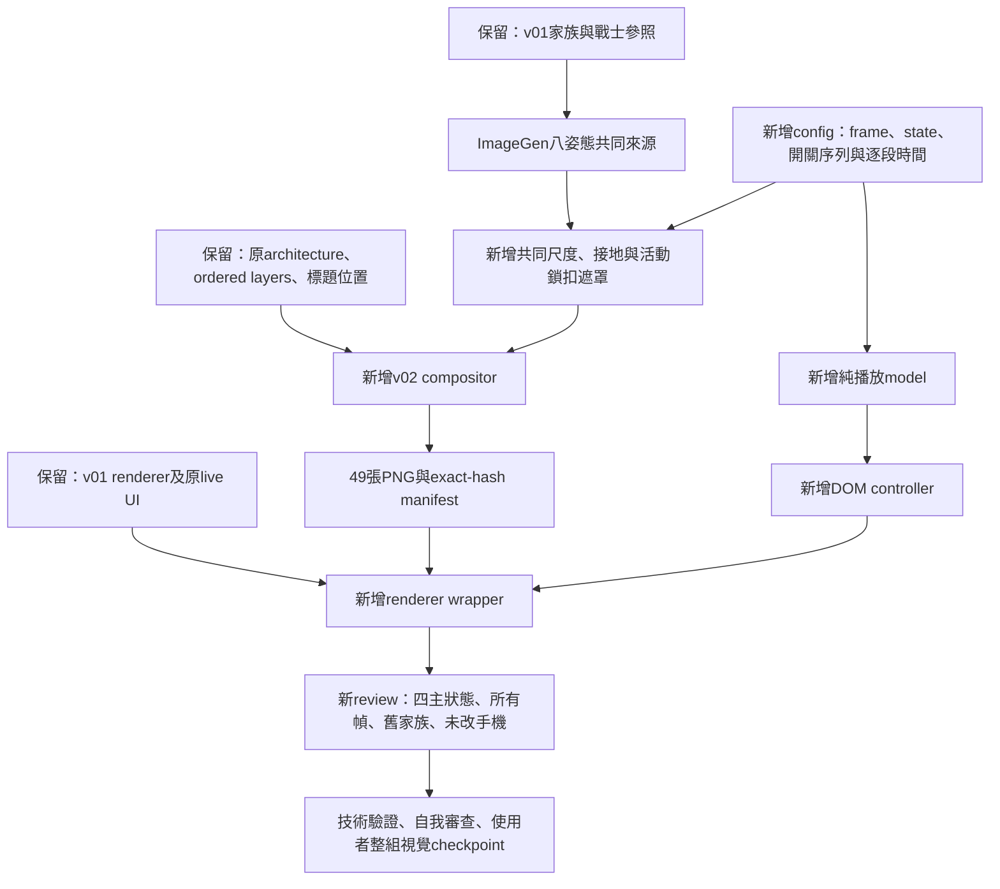

# Restored Landing Treasure Chest Implementation Plan

> **For agentic workers:** REQUIRED SUB-SKILL: Use `superpowers:executing-plans` task-by-task in this session. Inline only; no worktree, subagents, or execution-mode question. Checkbox steps track execution, not prior completion.

**Goal:** 製作同一只「小隊修整過、正在使用的珍藏老箱」，以四主狀態、必要過渡幀及有重量的開關節奏，改善故事感、手感與財寶吸引力。

**Architecture:** 舊v01家族、標題、手機、人物與其他道具全部保留。新增獨立v02素材與配置／播放／定位模組，以現有architecture和ordered layers重建場景；唯讀重用通用raster函式及v01 HTML renderer，再以新wrapper補上逐幀控制、原家族比較與節奏資料。

**Tech Stack:** built-in ImageGen、Node ESM、pngjs、Vitest、Playwright、native HTML buttons；不新增依賴，不連接產品runtime。

**Approved source:** [2026-10-19修訂規格](../specs/2026-10-19-landing-restored-treasure-chest-design.md)。本輪只寫計畫，尚未生成v02圖像或執行下列實作。

## 1. 既有與新增流程



現況來源（相對review根目錄）：`compose-treasure-chest-states.mjs:42`入口、`:100`原始script讀取、
`render-treasure-chest-states.mjs:5` renderer、`treasure-chest-state.controller.mjs:1` DOM接線、
`treasure-chest-state.model.mjs:17` toggle。舊model在第22/23行固定140ms；舊raster把最後30列整片重用。

本計畫不改這些舊檔。新model以frame ID與逐段時間播放，state只保留四個主語意；
新raster仍固定箱身，但不把閉合鎖扣的像素蓋回活動區域。新renderer wrapper只產生新頁，不能回寫v01。

## 2. 交付單位、分支與檔案責任

| 單位 | 分支／範圍 | 依賴與停止 | 建議commit message |
| --- | --- | --- | --- |
| P：本計畫 | 沿用checkout，僅本文 | 交付後等待使用者review／明確繼續 | `docs(visual): plan restored treasure chest refinement` |
| I：整組v02 | 同一checkout，新素材、管線、頁面、tests與devlog增量 | P核准後才執行；完成整組後視覺審核 | `feat(visual): refine restored treasure chest review` |

不建分支/worktree，不派遣subagent。由使用者手動commit；agent不stage、commit、push、PR。
I是一個可整組審核的預定commit單位；內部分TDD小步驟，不把未完成單張先要求核准。

`R/`在本文精確代表`docs/design/assets/reviews/2026-09-18-page-visual-phase-1/`。

| Create | 單一責任 |
| --- | --- |
| `R/restored-chest.config.mjs` | 八frame、四state、開關時間、固定定位 |
| `R/restored-chest.model.mjs` | 純播放／取消／ready／failure／reduced-motion |
| `R/restored-chest.controller.mjs` | native控制、decode、live狀態、不可用圖片遮蔽 |
| `R/restored-chest.raster.mjs` | 4×2來源分格、共同transform、活動鎖扣例外 |
| `R/render-restored-treasure-chest.mjs` | 唯讀包裝舊renderer，補足v02內容 |
| `R/compose-restored-treasure-chest.mjs` | provenance、scene重建、輸出與overwrite guard |
| `R/samples/derivations/treasure-chest-states-v02/attempt-01.png`及後續attempt | ImageGen原始bytes |
| 同目錄`family-source.png`、`prompt.md`、`lineage.json` | 選定原始atlas、實際提示、來源歷史 |
| `R/samples/treasure-chest-states-v02/*.png` | 49 deterministic review PNG |
| `R/restored-treasure-chest.manifest.json` | source/output hashes、frame/state、timelines、anchors |
| `R/restored-treasure-chest-review.html` | 新整組審核頁 |
| `R/restored-treasure-chest-verification.md` | 最後實測證據與self-review結果 |
| `web/src/shared/brand/restored-chest-model.test.ts` | 時序與取消等純行為 |
| `web/src/shared/brand/restored-treasure-chest.test.ts` | 真實PNG／provenance／determinism／guards |
| `web/e2e/restored-treasure-chest-review.spec.ts` | 四viewport實際browser驗證 |
| `web/e2e/restored-treasure-chest.playwright.config.ts` | 新spec加現有140 regressions |

唯一既有檔案修改為完成後append`.agents/devlog.md`。不修改舊規格／計畫／管線／contracts／HTML／PNG／manifest。
不改runtime、web/public、registry、PWA、SW、產品、Home、帳務、production exports或Phase 2。

## 3. 動作拆解與固定契約

| Frame（來源row-major） | 角色 | 主state | 肢體／遮擋 |
| --- | --- | --- | --- |
| closed | 主狀態 | closed | 蓋合、鎖扣扣妥 |
| latch-release | 過渡 | closed | 蓋仍合上，鎖扣半抬起 |
| unlatched | 過渡 | closed | 蓋合、鎖扣完全讓開；關閉時先回到此姿態 |
| cracked | 主狀態 | cracked | 窄縫、小量暖金反射 |
| half-open | 主狀態 | half-open | 清楚露出部分內蓋與堆疊財寶 |
| opening-wide | 過渡 | half-open | 蓋繼續抬起、遮擋減少 |
| near-open | 過渡 | half-open | 接近停穩，不超過終態再反彈 |
| open | 主狀態 | open | 蓋穩定全開，財寶仍在箱沿內 |

初始review時間：開啟750ms、關閉660ms。`after`表示**等待多久才進入該幀**，不是停留後再走的時間。
開啟先交代鎖扣、微開建立期待，中段順勢抬蓋，接近全開減速；關閉中段回落較快，蓋妥後才扣回。
這是可重現的初版review節奏，不是產品動畫核准；若視覺仍不自然，記錄具體段落與新時間，不以數字通過代替目視。

所有PNG共用104×120、scene origin(92,230)、local ground(52,120)、world ground(144,350)。
閉合仍在原(105,284)、78×66 footprint；標題桌機376/100/288×84、手機130/59/148×98不動。
活動鎖扣區域local(44,68)、36×40是**技術遮罩／review guide**，不是新物件位置決策。
只在這個區域容許鎖扣遮擋變化；箱身／腳的固定部分仍要求像素一致，區域內木材是否亂跳須人工核對。
若鎖扣實際動作超過遮罩，先核對來源／具體衝突，不擴大包絡或移動箱身來放行。

## 4. Task 1 — 只讀基線與執行前核對

- [ ] 讀AGENTS.md、`.agents/features.md`、核准規格、本文；使用executing-plans、TDD、imagegen，完工self-review與verification-before-completion。使用者已選Inline，不再問模式。
- [ ] root執行`git status --short`、`git log -5 --oneline`。確認預定新路徑不存在；若已有他人同名工作，停止，不覆蓋。
- [ ] 用以下唯讀命令保留當次status、index與所有舊檔hash於session紀錄；另保留devlog原始bytes供prefix驗證。不掃描attachments/reference內容。

```powershell
node -e 'const fs=require("fs"),p=require("path"),c=require("crypto"),cp=require("child_process");const hash=b=>c.createHash("sha256").update(b).digest("hex");const scan=d=>fs.readdirSync(d,{withFileTypes:true}).flatMap(e=>{const f=p.join(d,e.name);return e.isDirectory()?scan(f):[[f.replaceAll("\\","/"),hash(fs.readFileSync(f))]];});console.log(JSON.stringify({status:cp.execFileSync("git",["status","--short"],{encoding:"utf8"}),index:hash(cp.execFileSync("git",["diff","--cached","--binary"],{maxBuffer:20000000})),files:[...scan("docs/design/assets/reviews/2026-09-18-page-visual-phase-1"),...scan("web/src"),...scan("web/public"),...scan("web/e2e")],devlogBase64:fs.readFileSync(".agents/devlog.md").toString("base64")},null,2));'
```

- [ ] 核對pins：v01 manifest `61f1bf4e2ec7efca3e3c80a08af1852f674868094d8912962d2c40082c636cb1`；
  title-placement manifest `df90822ccb7fdd671899f08ec70c0d1535f16393d5b0ca4007aac0642d7eb1b5`；
  parent HTML `da5a81e41a8b3f5bda76732ac6c611731d87f386819883816250b5542c515c71`；
  手機logical `dae2872edddfa14d68b37c7b5475c4680381db0826dc417cb8a07ee370385ecf`。
- [ ] 舊raster與renderer只讀import，不執行舊composer。既有dirty tracked檔、暫存與未追蹤資料不還原、不清除；不使用git add .。

## 5. Task 2 — 模型測試RED，配置與模型GREEN

**Create:** `web/src/shared/brand/restored-chest-model.test.ts`。

- [ ] 先寫以下測試；缺模組時延後variable import讓測試真正執行，不讓Vite預解析得到零測試。

```ts
import {existsSync} from "node:fs";
import path from "node:path";
import {afterEach,expect,it,vi} from "vitest";
type Snap={frame:string;state:string;busy:boolean;error:string;ready:string[];canPlay:boolean};
type Model={snapshot:()=>Snap;available:(id:string,ok:boolean)=>void;selectFrame:(id:string)=>boolean;toggle:()=>boolean;dispose:()=>void};
type Factory=(o:{schedule:(fn:()=>void,ms:number)=>ReturnType<typeof setTimeout>;cancel:typeof clearTimeout;onChange:(s:Snap)=>void;reducedMotion:()=>boolean})=>Model;
const frames=["closed","latch-release","unlatched","cracked","half-open","opening-wide","near-open","open"];
const opening:[[string,number],...[string,number][]]=[["latch-release",100],["unlatched",90],["cracked",150],["half-open",90],["opening-wide",70],["near-open",110],["open",140]];
const closing:[[string,number],...[string,number][]]=[["near-open",120],["opening-wide",100],["half-open",80],["cracked",70],["unlatched",90],["latch-release",80],["closed",120]];
async function setup(reduced=false){
  const url=path.resolve(process.cwd(),"../docs/design/assets/reviews/2026-09-18-page-visual-phase-1/restored-chest.model.mjs");
  expect(existsSync(url),"Restored model required").toBe(true);
  const {createChestStateModel}=await import(/* @vite-ignore */ url) as {createChestStateModel:Factory};
  vi.useFakeTimers();const trace:Snap[]=[];
  const m=createChestStateModel({schedule:(f,ms)=>setTimeout(f,ms),cancel:clearTimeout,onChange:s=>trace.push(s),reducedMotion:()=>reduced});
  return {m,trace,ready:()=>frames.forEach(id=>m.available(id,true))};
}
afterEach(()=>{vi.clearAllTimers();vi.useRealTimers();});
it("waits for all eight decoded frames and never autoplays",async()=>{
  const {m,ready}=await setup();expect(m.toggle()).toBe(false);ready();expect(m.snapshot()).toMatchObject({frame:"closed",state:"closed",busy:false,canPlay:true});expect(vi.getTimerCount()).toBe(0);
});
it("uses the exact nonuniform opening and different closing delays",async()=>{
  const {m,ready}=await setup();ready();m.toggle();let total=0;
  for(const [id,ms] of opening){vi.advanceTimersByTime(ms-1);expect(m.snapshot().frame).not.toBe(id);vi.advanceTimersByTime(1);expect(m.snapshot().frame).toBe(id);total+=ms;}
  expect(total).toBe(750);expect(m.snapshot().busy).toBe(false);m.toggle();total=0;
  for(const [id,ms] of closing){vi.advanceTimersByTime(ms);expect(m.snapshot().frame).toBe(id);total+=ms;}
  expect(total).toBe(660);expect(vi.getTimerCount()).toBe(0);
});
it("maps transitional frames to only four semantic states",async()=>{
  const {m,ready}=await setup();ready();
  for(const [frame,state] of frames.map((id,i)=>[id,i===7?"open":i>=4?"half-open":i===3?"cracked":"closed"])){
    m.selectFrame(frame);expect(m.snapshot()).toMatchObject({frame,state});
  }
});
it("does not queue repeated toggles",async()=>{
  const {m,ready}=await setup();ready();m.toggle();expect(m.toggle()).toBe(false);expect(vi.getTimerCount()).toBe(1);vi.runAllTimers();expect(m.snapshot().frame).toBe("open");expect(vi.getTimerCount()).toBe(0);
});
it("manual frame selection cancels playback",async()=>{
  const {m,ready}=await setup();ready();m.toggle();vi.advanceTimersByTime(190);m.selectFrame("half-open");vi.runAllTimers();expect(m.snapshot()).toMatchObject({frame:"half-open",busy:false});
});
it("resumes opening after a manually selected intermediate without a backward jump",async()=>{
  const {m,ready}=await setup();ready();m.selectFrame("cracked");m.toggle();vi.advanceTimersByTime(90);expect(m.snapshot().frame).toBe("half-open");vi.runAllTimers();expect(m.snapshot().frame).toBe("open");
});
it("reduced motion switches directly to terminal frames and retains manual inspection",async()=>{
  const {m,ready}=await setup(true);ready();m.toggle();expect(m.snapshot()).toMatchObject({frame:"open",busy:false});m.toggle();expect(m.snapshot().frame).toBe("closed");
  for(const id of frames){expect(m.selectFrame(id)).toBe(true);expect(m.snapshot().frame).toBe(id);}expect(vi.getTimerCount()).toBe(0);
});
it("failed transition stops playback and invalid IDs cannot enter the model",async()=>{
  const {m,ready}=await setup();ready();m.toggle();m.available("near-open",false);vi.runAllTimers();expect(m.snapshot()).toMatchObject({frame:"closed",busy:false,canPlay:false,error:"無法載入：near-open"});
  expect(m.selectFrame("near-open")).toBe(false);expect(m.selectFrame("unknown")).toBe(false);expect(()=>m.available("unknown",true)).toThrow("Unknown frame");
});
it("reports current-frame failure and dispose cancels the only timer",async()=>{
  const {m,ready}=await setup();ready();m.selectFrame("open");m.available("open",false);expect(m.snapshot().ready).not.toContain("open");expect(m.snapshot().canPlay).toBe(false);
  m.available("open",true);m.toggle();m.dispose();expect(vi.getTimerCount()).toBe(0);expect(m.snapshot().busy).toBe(false);
});
```

- [ ] `web/`執行`npm test -- src/shared/brand/restored-chest-model.test.ts`，確認9個真正RED，原因為缺model而非cache權限／missing-browser／零測試。
- [ ] 新增`R/restored-chest.config.mjs`完整內容：

```js
export const frames=["closed","latch-release","unlatched","cracked","half-open","opening-wide","near-open","open"];
export const mainFrames={closed:"closed",cracked:"cracked","half-open":"half-open",open:"open"};
export const timelines={
  open:[["latch-release",100],["unlatched",90],["cracked",150],["half-open",90],["opening-wide",70],["near-open",110],["open",140]],
  close:[["near-open",120],["opening-wide",100],["half-open",80],["cracked",70],["unlatched",90],["latch-release",80],["closed",120]],
};
export const layout={width:104,height:120,sceneOrigin:[92,230],ground:[52,120],worldGround:[144,350],bodyStart:90,latchArea:{x:44,y:68,width:36,height:40},hingeReference:{kind:"review-guide",point:[52,84]}};
export function stateOfFrame(id){
  const n=frames.indexOf(id);if(n<0)throw Error("Unknown frame");
  return n===7?"open":n>=4?"half-open":n===3?"cracked":"closed";
}
```

- [ ] 新增`R/restored-chest.model.mjs`完整內容：

```js
import {frames,timelines,stateOfFrame} from "./restored-chest.config.mjs";
export function createChestStateModel({schedule,cancel,onChange,reducedMotion}){
  let frame="closed",busy=false,timer=null,error="";const ready=new Set();
  const snapshot=()=>({frame,state:stateOfFrame(frame),busy,error,ready:[...ready],canPlay:ready.size===frames.length&&!busy});
  const emit=()=>onChange(snapshot());
  const stop=()=>{if(timer!==null)cancel(timer);timer=null;busy=false;};
  function available(id,ok){
    if(!frames.includes(id))throw Error("Unknown frame");
    if(ok)ready.add(id);else{ready.delete(id);stop();error="無法載入："+id;}emit();
  }
  function selectFrame(id){
    if(!frames.includes(id)||!ready.has(id))return false;
    stop();frame=id;emit();return true;
  }
  function toggle(){
    if(busy||ready.size!==frames.length)return false;
    const direction=frame==="open"?"close":"open",target=direction==="open"?"open":"closed";
    if(reducedMotion()){frame=target;emit();return true;}
    const sequence=timelines[direction],start=sequence.findIndex(([id])=>id===frame),steps=sequence.slice(start+1);
    busy=true;emit();
    const next=index=>{timer=schedule(()=>{
      timer=null;frame=steps[index][0];
      if(index+1===steps.length)busy=false;else next(index+1);emit();
    },steps[index][1]);};
    next(0);return true;
  }
  emit();return {snapshot,available,selectFrame,toggle,dispose:stop};
}
```

- [ ] 檔案存在後把test的variable import改為literal `import("../../../../docs/design/assets/reviews/2026-09-18-page-visual-phase-1/restored-chest.model.mjs")`，保留存在斷言與全部行為斷言。這只處理Windows Vite載入方式，不削弱RED。
- [ ] 重跑相同命令，預期9 PASS。實際結果才是證據；計畫本文中的預期不等於已驗證。

## 6. Task 3 — ImageGen整組來源與歷史

- [ ] 完整讀imagegen skill及必讀reference；逐張view_image檢查v01 atlas、closed實際sprite、warrior master、實際warrior layer及v01 closed場景。不是把SHA核對當成看過圖片。
- [ ] built-in ImageGen編修一個4×2 atlas，以v01 atlas作edit target，warrior master、實際warrior layer、v01 closed logical scene作三張references。`transparent_background:true`。不得用程式畫修復鐵件、蓋子、財寶，不能用CSS旋轉既有圖冒充過渡稿。
- [ ] 起始完整prompt如下；`prompt.md`記錄實際送出版本與每次定點修訂，不捏造尚未生成的hash：

```text
Use case: precise-object-edit. Asset: ONE coordinated 4-column by 2-row transparent pixel-art sprite family of the same repaired old treasure chest. Image 1 is the previous four-state chest family, the edit target. Image 2 is the warrior master style reference. Image 3 is the actual warrior layer pixel-cluster reference. Image 4 is only the fixed room scale/lighting context. Render no room, character or title.

Identity: the adventuring party repaired a wooden chest left in this old treasure room and now uses it to guard valued spoils. Preserve the ordinary round-arched wooden lid, iron straps, original three-quarter facing with left end panel and broad front, hinge placement and ground footprint. Deep warm brown wood, broad readable planks, a few purposeful wear marks, slightly polished contact edges. ONE visibly replaced lower-corner iron fitting with modestly different iron tone/rivets, still strong and well maintained. A more substantial understandable mechanical latch is the main focal detail, never a face or magic mechanism. No badges, lettering, ropes, hanging charms, dense scratches, rust field or extra props.

Eight equal cells in row-major order: 1 closed and latched; 2 lid still fully shut, latch halfway lifting; 3 lid fully shut, latch fully clear; 4 narrowly cracked lid with a small reflected warm-gold glimpse; 5 half-open showing part of the inner lid and treasure; 6 opening wider; 7 almost fully open, decelerating without overshoot; 8 fully open at rest. Every moving latch is mechanically connected and clears the rim before the lid moves. The shut-but-unlatched pose also works for closing before the latch drops. The lid does not float or detach. Do not change body scale, feet, perspective, corner repair or iron-band identity between cells.

All cells share the exact same body horizontal center and feet baseline, with identical transparent framing. Center at 50 percent of each cell width; baseline about90 percent cell height. Closed chest visible proportions match78x66 logical pixels; about75 percent cell width, with height derived from the same scale. Leave ample identical headroom for open lids and clear transparent margins on every cell edge. Do not shrink a body to fit its lid or tightly fit states independently. No cell separators or captions.

Inside: irregular overlapping small gold-coin heaps with depth and selective dark occlusion behind the rim. A few restrained gems form one secondary cluster, one blue-teal gem accents warm gold. Not a rainbow display. Dark wooden inner lid and cavity; selective broken fire-reflection highlights, no emitted light. Treasure stays entirely inside the rim in every state; no flying coins, floor loot, beam, halo, flash, particles, symbols or rewards. Fire and companions remain the room's primary focus.

Match the warrior's fine deliberate pixel clusters, stepped dark-brown-black outlines, two or three principal material shades, broken highlights, clear joints and handmade asymmetry. Avoid smooth gradients/vector contours, blur, plastic gloss, noisy stippling, photoreal rendering and incoherent AI ornament. Keep the fixed lower body pixel-consistent across all eight cells, leaving only the latch's local occlusion free to move. No text, numbers, UI frame, stage, ground plane, sound symbols, Mimiku eyes/mouth/teeth, or extra objects. Actual transparent background.
```

- [ ] 每次原始輸出保留為`attempt-01.png`、`attempt-02.png`等新檔。先view_image再做透明／定位檢查；若錯透視、箱身漂移或鎖扣穿插，針對同一atlas修訂，不用個別fit/warp掩蓋。
- [ ] 選定attempt原樣複製為`family-source.png`，兩檔SHA必須一致。記錄來源路徑與prompt；舊v01不覆寫。不要把生成圖片的base64全文印出。
- [ ] apply_patch新增`prompt.md`與以下初始`lineage.json`。若有第二次以上生成，history按真實順序追加，editTargetPath指前一次attempt；後續referencePaths若沒有額外references就為空陣列。selected來源bytes須等於history最後一張。

```json
{
  "schema": "mimic-restored-chest-source/v1",
  "generator": "imagegen",
  "transparent": true,
  "parentPath": "docs/design/assets/reviews/2026-09-18-page-visual-phase-1/samples/derivations/treasure-chest-states-v01/family-source.png",
  "selectedPath": "docs/design/assets/reviews/2026-09-18-page-visual-phase-1/samples/derivations/treasure-chest-states-v02/family-source.png",
  "frames": ["closed", "latch-release", "unlatched", "cracked", "half-open", "opening-wide", "near-open", "open"],
  "history": [
    {
      "path": "docs/design/assets/reviews/2026-09-18-page-visual-phase-1/samples/derivations/treasure-chest-states-v02/attempt-01.png",
      "editTargetPath": "docs/design/assets/reviews/2026-09-18-page-visual-phase-1/samples/derivations/treasure-chest-states-v01/family-source.png",
      "referencePaths": [
        "docs/design/assets/reviews/2026-09-18-page-visual-phase-1/samples/avatar-classes/masters/warrior.png",
        "docs/design/assets/reviews/2026-09-18-page-visual-phase-1/samples/landing-warm-rest/layers/A-desktop/warrior.png",
        "docs/design/assets/reviews/2026-09-18-page-visual-phase-1/samples/treasure-chest-states-v01/closed-logical.png"
      ]
    }
  ]
}
```

## 7. Task 4 — 共用transform與活動鎖扣區域（先artifact RED）

- [ ] 先寫Task 7完整artifact test並跑RED；不存在的compositor/raster使用與Task 2相同的延後import策略，存在後改literal import，避免Vite預解析或Windows drive loss。不能把missing-module錯誤的零測試當RED。
- [ ] 新增`R/restored-chest.raster.mjs`如下。每格取同樣整數尺寸，餘數只允許落在透明gutter；不重新縮放某一格或默默丟棄可見pixels。

```js
import {createRequire} from "node:module";
import path from "node:path";
import {fileURLToPath} from "node:url";
import {bounds,nearest} from "./landing-chest-raster.mjs";
import {layout,frames} from "./restored-chest.config.mjs";
const repo=path.resolve(path.dirname(fileURLToPath(import.meta.url)),"../../../../..");
const {PNG}=createRequire(path.join(repo,"web/package.json"))("pngjs");
export function inLatch(x,y){const a=layout.latchArea;return x>=a.x&&x<a.x+a.width&&y>=a.y&&y<a.y+a.height;}
export function prepareRestoredFamily(atlas){
  const cw=Math.floor(atlas.width/4),ch=Math.floor(atlas.height/2);
  if(cw<2||ch<2)throw Error("Atlas too small");
  if(!atlas.data.some((v,i)=>i%4===3&&v===0))throw Error("Transparent source required");
  const cells=frames.map((id,i)=>({x:Math.round((i%4)*atlas.width/4),y:Math.round(Math.floor(i/4)*atlas.height/2),width:cw,height:ch}));
  const covered=new Uint8Array(atlas.width*atlas.height);
  for(const c of cells)for(let y=0;y<ch;y++)for(let x=0;x<cw;x++)covered[(c.y+y)*atlas.width+c.x+x]=1;
  for(let i=0;i<covered.length;i++)if(!covered[i]&&atlas.data[i*4+3]>=200)throw Error("Opaque atlas gutter");
  const raw=cells.map(c=>nearest(atlas,cw,ch,c)),boxes=raw.map(p=>bounds(p));
  for(const b of boxes)if(b.x===0||b.y===0||b.x+b.width===cw||b.y+b.height===ch)throw Error("Source touches cell edge");
  const b=boxes[0],scale=Math.min(78/b.width,66/b.height),anchor=[b.x+b.width/2,b.y+b.height];
  if(Math.round(b.width*scale)<74||Math.round(b.height*scale)<62)throw Error("Closed proportions mismatch");
  for(const box of boxes){
    const left=52+(box.x-anchor[0])*scale,top=120+(box.y-anchor[1])*scale;
    if(left<1||top<1||left+box.width*scale>103||top+box.height*scale>120.5)throw Error("Common envelope exceeded");
  }
  const sprites=raw.map(p=>{
    const out=new PNG({width:104,height:120});
    for(let y=0;y<120;y++)for(let x=0;x<104;x++){
      const sx=Math.floor(anchor[0]+(x-52)/scale),sy=Math.floor(anchor[1]+(y-120)/scale),di=(y*104+x)*4;
      if(sx<0||sy<0||sx>=cw||sy>=ch)continue;
      const si=(sy*cw+sx)*4;if(p.data[si+3]<200)continue;
      out.data.set(p.data.subarray(si,si+3),di);out.data[di+3]=255;
    }
    return out;
  });
  const bands=sprites.map(p=>bounds(nearest(p,104,30,{x:0,y:90,width:104,height:30})));
  for(const q of bands){const a=bands[0];if(Math.abs(q.x-a.x)>2||Math.abs(q.width-a.width)>4||Math.abs(q.y+q.height-a.y-a.height)>2)throw Error("Body registration mismatch");}
  for(const p of sprites.slice(1))for(let y=90;y<120;y++)for(let x=0;x<104;x++){
    if(inLatch(x,y))continue;const i=(y*104+x)*4;p.data.set(sprites[0].data.subarray(i,i+4),i);
  }
  return {sprites,registration:{cells,boxes,scale,rawAnchor:anchor,rawBodyBands:bands,bodyReuse:{from:"closed",startRow:90,except:layout.latchArea}}};
}
```

- [ ] 人工核對活動區域內只有合理的鎖扣／其遮擋變化，不接受木板、修復鐵件跟著抖動。共用下部像素只複用ImageGen內容，不程序補畫新零件。

## 8. Task 5 — 新controller與renderer wrapper

- [ ] 先建立Task 8 browser spec，執行`npx playwright test --config=e2e/restored-treasure-chest.playwright.config.ts restored-treasure-chest-review.spec.ts --project=desktop`，確認六個cases因新頁不存在而真正RED；此時不建立假的HTML或替代圖片。
- [ ] 新增`R/restored-chest.controller.mjs`。保留同名mount export只為沿用舊renderer的啟動接點，不修改舊controller。

```js
export async function mountChestStates(factory,root=document){
  const host=root.querySelector("[data-chest-preview]"),img=host?.querySelector(".scene picture img");if(!host||!img)return;
  const stateButtons=[...host.querySelectorAll("[data-pick]")],frameButtons=[...host.querySelectorAll("[data-frame-pick]")];
  const plays=[...host.querySelectorAll("[data-toggle]")],assets=[...host.querySelectorAll("[data-state-asset]")];
  const status=host.querySelector("[data-current]"),error=host.querySelector("[data-error]");
  const model=factory({schedule:(fn,ms)=>setTimeout(fn,ms),cancel:id=>clearTimeout(id),reducedMotion:()=>matchMedia("(prefers-reduced-motion: reduce)").matches,
    onChange:s=>{
      host.dataset.frame=s.frame;host.dataset.state=s.state;host.dataset.busy=String(s.busy);status.textContent=s.state+" / "+s.frame;error.textContent=s.error;
      const a=assets.find(a=>a.dataset.stateAsset===s.frame),valid=s.ready.includes(s.frame);
      img.style.visibility=valid?"visible":"hidden";if(a&&valid)img.src=a.src;
      for(const b of stateButtons){b.disabled=!s.ready.includes(b.dataset.pick);b.setAttribute("aria-pressed",String(b.dataset.pick===s.state));}
      for(const b of frameButtons){b.disabled=!s.ready.includes(b.dataset.framePick);b.setAttribute("aria-pressed",String(b.dataset.framePick===s.frame));}
      for(const b of plays){b.disabled=!s.canPlay;b.setAttribute("aria-label",s.frame==="open"?"關閉藏寶箱":"開啟藏寶箱");}
    }});
  for(const b of stateButtons)b.addEventListener("click",()=>model.selectFrame(b.dataset.pick));
  for(const b of frameButtons)b.addEventListener("click",()=>model.selectFrame(b.dataset.framePick));
  for(const b of plays)b.addEventListener("click",()=>model.toggle());
  await Promise.all(assets.map(async a=>{let failed=false;const fail=()=>{failed=true;model.available(a.dataset.stateAsset,false);};a.addEventListener("error",fail);try{await a.decode();if(!failed)model.available(a.dataset.stateAsset,true);}catch{fail();}}));
  host.dataset.loaded="true";return model;
}
```

- [ ] 新增`R/render-restored-treasure-chest.mjs`。舊renderer輸出僅作記憶體輸入；新wrapper補齊其只知道四主狀態的部分，legacy檔案完全不回寫。

```js
import {renderTreasureChestReview} from "./render-treasure-chest-states.mjs";
import {frames,mainFrames,timelines} from "./restored-chest.config.mjs";
const prefix="docs/design/assets/reviews/2026-09-18-page-visual-phase-1/";
const rel=a=>a.path.slice(prefix.length);
const esc=s=>String(s).replaceAll("&","&amp;").replaceAll("<","&lt;").replaceAll(">","&gt;").replaceAll('"',"&quot;");
export function renderRestoredChestReview(m,parentHTML,scripts){
  let html=renderTreasureChestReview(m,parentHTML,scripts);
  const swap=(from,to)=>{if(!html.includes(from))throw Error("Missing legacy boundary: "+from);html=html.replace(from,to);};
  html=html.replaceAll("Landing — 藏寶箱四態比較","Landing — 修整老箱與重量開關")
    .replaceAll('href="treasure-chest-states.manifest.json"','href="restored-treasure-chest.manifest.json"');
  swap("播放140ms一段、三段420ms","開啟750ms／關閉660ms，逐段時間不同");
  swap('</h1>','</h1><p>小隊修整過、正在使用的珍藏老箱：深暖木材、一處下角修復、有份量的鎖扣；逐步揭露堆疊金幣與青藍寶石。篝火與伙伴仍為主角。</p>');
  const picks=frames.map(id=>'<button type="button" data-frame-pick="'+id+'" aria-pressed="false" disabled>'+id+'</button>').join("");
  swap('</div><p role="status">','</div><div class="controls frame-controls">'+picks+'</div><p role="status">');
  const extra=frames.filter(id=>!Object.values(mainFrames).includes(id));
  const preload=extra.map(id=>'').join("");
  swap('<section class="candidate" data-candidate="desktop-single">',preload+'<section class="candidate" data-candidate="desktop-single">');
  const figure=(a,label,actual=false)=>'<figure><figcaption>'+esc(label)+'</figcaption></figure>';
  const card=(id,f,old=false)=>'<section class="state-card" '+(old?'data-old-state="':'data-transition="')+id+'"><h3>'+id+'</h3>'+figure(f.sprite,(old?"v01 ":"v02 ")+id+" 實際104×120",true)+(old?"":figure(f.zoom,id+" 2×")+figure(f.spriteGray,id+" 真實灰階",true))+'</section>';
  const transitions='<h2>必要過渡幀（同一物件，不是新候選）</h2><div class="state-gallery">'+extra.map(id=>card(id,m.frames[id])).join("")+'</div>';
  const old='<h2>v01原四態家族（保留、尚未核准）</h2><div class="state-gallery">'+Object.keys(mainFrames).map(id=>card(id,m.oldFrames[id],true)).join("")+'</div>';
  const timing='<h2>可重現開／關節奏</h2><pre class="timing">'+esc(JSON.stringify(timelines,null,2))+'</pre><p>after為進入該幀前的等待毫秒；state只有四個，frame共有八個。此節奏僅供review。</p>';
  swap('<h2>原閉合候選與戰士基準</h2>',transitions+old+timing+'<h2>原閉合候選與戰士基準</h2>');
  swap('</head>','<style>.timing{white-space:pre-wrap;overflow-wrap:anywhere}.frame-controls{margin-top:8px}.frame-controls button{min-width:44px}</style></head>');
  if((html.match(/data-state-asset=/g)??[]).length!==8||(html.match(/data-frame-pick=/g)??[]).length!==8||(html.match(/data-chapter/g)??[]).length!==4||html.includes("播放140ms一段"))throw Error("Incomplete v02 review");
  return html;
}
```

圖頁保留四個主state按鈕，另有八個frame按鈕。只把舊renderer當layout／live UI重用，不能讓新頁還寫舊420ms、連到舊manifest或缺四張preload。

## 9. Task 6 — 獨立compositor與49張真實PNG

- [ ] artifact/browser RED已觀察後，新增`R/compose-restored-treasure-chest.mjs`。import不寫檔；只CLI或明確呼叫compose才寫入新版本。

```js
import {createHash} from "node:crypto";
import {readFile,writeFile,mkdir} from "node:fs/promises";
import path from "node:path";
import {fileURLToPath} from "node:url";
import {createRequire} from "node:module";
import {isDeepStrictEqual as equal} from "node:util";
import {nearest,over,gray} from "./landing-chest-raster.mjs";
import {frames,mainFrames,timelines,layout} from "./restored-chest.config.mjs";
import {prepareRestoredFamily} from "./restored-chest.raster.mjs";
import {renderRestoredChestReview} from "./render-restored-treasure-chest.mjs";
const dir=path.dirname(fileURLToPath(import.meta.url)),repo=path.resolve(dir,"../../../../..");
const {PNG}=createRequire(path.join(repo,"web/package.json"))("pngjs");
const prefix="docs/design/assets/reviews/2026-09-18-page-visual-phase-1/",sourceDir="samples/derivations/treasure-chest-states-v02/";
const hash=b=>createHash("sha256").update(b).digest("hex"),relative=f=>path.relative(repo,f).replaceAll("\\","/");
async function bytes(a){
  const file=path.resolve(repo,a.path);if(!file.startsWith(dir+path.sep))throw Error("Input outside review");
  const b=await readFile(file);if(hash(b)!==a.sha256)throw Error("Changed input: "+a.path);return b;
}
async function png(a){const p=PNG.sync.read(await bytes(a));if(p.width!==a.width||p.height!==a.height)throw Error("Changed dimensions");return p;}
async function record(name,raster=false){
  const file=path.join(dir,name),b=await readFile(file),a={path:relative(file),sha256:hash(b)};
  if(!raster)return a;const p=PNG.sync.read(b);return {...a,width:p.width,height:p.height};
}
async function build(parent,replacement){
  const a=await png(parent.sources.architectureDesktop),ratio=960/540;
  const cw=a.width/a.height>ratio?Math.round(a.height*ratio):a.width,ch=a.width/a.height>ratio?a.height:Math.round(a.width/ratio);
  const out=nearest(a,960,540,{x:Math.floor((a.width-cw)/2),y:Math.floor((a.height-ch)/2),width:cw,height:ch});
  for(let i=3;i<out.data.length;i+=4)out.data[i]=255;
  for(const l of parent.scenes.desktop.layers){
    if(l.id!=="chest"||replacement===undefined)over(out,await png(l),l.x,l.y);
    else if(replacement!==null)over(out,replacement,...layout.sceneOrigin);
  }
  const t=parent.frames["desktop-single"].title;over(out,await png(t),t.x,t.y);return out;
}
export async function composeRestoredChest(){
  const oldRecord={path:prefix+"treasure-chest-states.manifest.json",sha256:"61f1bf4e2ec7efca3e3c80a08af1852f674868094d8912962d2c40082c636cb1"};
  const old=JSON.parse((await bytes(oldRecord)).toString()),parentRecord=old.inputs.parent;
  if(parentRecord.sha256!=="df90822ccb7fdd671899f08ec70c0d1535f16393d5b0ca4007aac0642d7eb1b5")throw Error("Wrong parent");
  const parent=JSON.parse((await bytes(parentRecord)).toString()),before=parent.frames["desktop-single"],phone=parent.frames["phone-staggered"];
  const chest=parent.scenes.desktop.layers.find(l=>l.id==="chest");
  if(!chest||!equal([chest.x,chest.y,chest.width,chest.height],[105,284,78,66])||
     !equal([before.title.x,before.title.y,before.title.width,before.title.height],[376,100,288,84])||
     !equal([phone.title.x,phone.title.y,phone.title.width,phone.title.height],[130,59,148,98]))throw Error("Frozen geometry mismatch");
  const inputs={old:oldRecord,parent:parentRecord,oldSource:old.inputs.source,closedLayer:old.inputs.closedLayer,
    warriorMaster:old.inputs.warriorMaster,warriorLayer:old.inputs.warriorLayer,referenceScene:old.frames.closed.logical,
    source:await record(sourceDir+"family-source.png",true),prompt:await record(sourceDir+"prompt.md"),lineage:await record(sourceDir+"lineage.json"),
    parentReview:old.inputs.parentReview,sharedRaster:await record("landing-chest-raster.mjs"),legacyRenderer:await record("render-treasure-chest-states.mjs"),
    config:await record("restored-chest.config.mjs"),model:await record("restored-chest.model.mjs"),controller:await record("restored-chest.controller.mjs"),
    raster:await record("restored-chest.raster.mjs"),renderer:await record("render-restored-treasure-chest.mjs"),composer:await record("compose-restored-treasure-chest.mjs")};
  if(inputs.parentReview.sha256!=="da5a81e41a8b3f5bda76732ac6c611731d87f386819883816250b5542c515c71")throw Error("Parent review changed");
  if(inputs.sharedRaster.sha256!==old.inputs.sharedRaster.sha256||inputs.legacyRenderer.sha256!==old.inputs.renderer.sha256)throw Error("Legacy module changed");
  for(const a of [inputs.oldSource,inputs.closedLayer,inputs.warriorMaster,inputs.warriorLayer,inputs.referenceScene,phone.logical,phone.color,phone.gray,phone.title,before.title])await png(a);
  if(phone.logical.sha256!=="dae2872edddfa14d68b37c7b5475c4680381db0826dc417cb8a07ee370385ecf")throw Error("Frozen phone changed");
  for(const f of Object.values(old.frames))for(const a of [f.sprite,f.spriteGray,f.zoom,f.logical,f.color,f.gray])await png(a);
  const lineage=JSON.parse((await bytes(inputs.lineage)).toString()),references=[inputs.warriorMaster,inputs.warriorLayer,inputs.referenceScene];
  if(lineage.schema!=="mimic-restored-chest-source/v1"||lineage.generator!=="imagegen"||lineage.transparent!==true||lineage.parentPath!==inputs.oldSource.path||lineage.selectedPath!==inputs.source.path||!equal(lineage.frames,frames)||!Array.isArray(lineage.history)||!lineage.history.length)throw Error("Invalid ImageGen lineage");
  const sourceHistory=[];
  for(const [i,entry] of lineage.history.entries()){
    const name="attempt-"+String(i+1).padStart(2,"0")+".png",target=i?sourceHistory[i-1].source:inputs.oldSource;
    if(entry.path!==prefix+sourceDir+name||entry.editTargetPath!==target.path||!equal(entry.referencePaths,i?[]:references.map(a=>a.path)))throw Error("Invalid edit history");
    const source=await record(sourceDir+name,true);await png(source);sourceHistory.push({source,editTarget:target,references:i?[]:references});
  }
  if(sourceHistory.at(-1).source.sha256!==inputs.source.sha256)throw Error("Selected source is not final ImageGen bytes");
  const baseline=await png(before.logical),rebuilt=await build(parent);
  if(!rebuilt.data.equals(baseline.data))throw Error("Old reconstruction mismatch");
  const family=prepareRestoredFamily(await png(inputs.source)),writes=new Map(),outputs={},reviewFrames={};
  if(new Set(family.sprites.map(p=>hash(p.data))).size!==frames.length)throw Error("Duplicate normalized frames");
  const save=(name,p)=>{
    const file=path.join(dir,"samples/treasure-chest-states-v02",name+".png"),b=PNG.sync.write(p);writes.set(file,b);
    const a={path:relative(file),sha256:hash(b),width:p.width,height:p.height};outputs[name]=a;return a;
  };
  const without=await build(parent,null);
  if(!without.data.equals((await png(old.backdrop)).data))throw Error("Old chest-free background mismatch");
  const backdrop=save("desktop-without-chest",without);
  for(const [i,id] of frames.entries()){
    const sprite=family.sprites[i],logical=await build(parent,sprite);let changed=0;
    for(let y=0;y<540;y++)for(let x=0;x<960;x++){
      const n=(y*960+x)*4;if(logical.data.subarray(n,n+4).equals(baseline.data.subarray(n,n+4)))continue;
      if(x<92||x>=196||y<230||y>=350)throw Error("Outside chest envelope");changed++;
    }
    if(!changed)throw Error("No visible chest change");const color=nearest(logical,1920,1080);
    reviewFrames[id]={source:{...inputs.source,cell:family.registration.cells[i]},canvas:[104,120],sceneOrigin:layout.sceneOrigin,ground:layout.ground,worldGround:layout.worldGround,hingeReference:layout.hingeReference,title:before.title,changedPixels:changed,
      sprite:save(id+"-sprite",sprite),spriteGray:save(id+"-sprite-gray",gray(sprite)),zoom:save(id+"-2x",nearest(sprite,208,240)),
      logical:save(id+"-logical",logical),color:save(id+"-color",color),gray:save(id+"-gray",gray(color))};
  }
  const modelText=(await bytes(inputs.model)).toString(),importLine='import {frames,timelines,stateOfFrame} from "./restored-chest.config.mjs";';
  if(modelText.split(importLine).length!==2)throw Error("Model import contract changed");
  const scripts={model:(await bytes(inputs.config)).toString()+"\n"+modelText.replace(importLine,""),controller:(await bytes(inputs.controller)).toString()};
  const m={schema:"mimic-restored-chest-review/v1",decision:"awaiting-calibration",reviewOnly:true,runtimePromotion:false,
    spec:"docs/superpowers/specs/2026-10-19-landing-restored-treasure-chest-design.md",plan:"docs/superpowers/plans/2026-10-20-landing-restored-treasure-chest.md",
    inputs,sourceHistory,config:{frames,mainFrames,timelines,layout},layout,registration:family.registration,backdrop,outputs,frames:reviewFrames,oldFrames:old.frames,parentDesktop:before,phone};
  const html=renderRestoredChestReview(m,(await bytes(inputs.parentReview)).toString(),scripts),htmlFile=path.join(dir,"restored-treasure-chest-review.html"),manifestFile=path.join(dir,"restored-treasure-chest.manifest.json");
  const complete={...m,review:{path:relative(htmlFile),sha256:hash(html)}};writes.set(htmlFile,Buffer.from(html));let previous;
  try{previous=JSON.parse(await readFile(manifestFile,"utf8"));}catch(e){if(e.code!=="ENOENT")throw e;}
  if(previous){
    if(!equal(Object.keys(previous.outputs??{}).sort(),Object.keys(outputs).sort())||previous.review?.path!==relative(htmlFile))throw Error("Existing output set differs");
    const stable=v=>Object.fromEntries(Object.entries(v).filter(([k])=>!["config","model","controller","raster","renderer","composer"].includes(k)));
    if(!equal(stable(previous.inputs),stable(inputs))||!equal(previous.sourceHistory,sourceHistory))throw Error("Existing provenance differs");
    for(const a of [...Object.values(previous.outputs),previous.review]){if(!writes.has(path.resolve(repo,a.path)))throw Error("Unexpected target");await bytes(a);}
  }else for(const file of writes.keys())try{await readFile(file);throw Error("Unexpected existing output");}catch(e){if(e.code!=="ENOENT")throw e;}
  for(const [file,b] of writes){await mkdir(path.dirname(file),{recursive:true});await writeFile(file,b);}
  await writeFile(manifestFile,JSON.stringify(complete,null,2)+"\n");return complete;
}
if(process.argv[1]&&path.resolve(process.argv[1])===fileURLToPath(import.meta.url))console.log(JSON.stringify(await composeRestoredChest(),null,2));
```

- [ ] 執行root命令`node docs/design/assets/reviews/2026-09-18-page-visual-phase-1/compose-restored-treasure-chest.mjs`。預期49張新PNG：1張without-chest、八幀各sprite／sprite-gray／2x／logical／color／gray共48張，另新HTML與manifest。
- [ ] Guard失敗時先找原因；不能刪manifest或改舊來源來強行覆蓋。程式修正可以在核對原輸出hash後重建；ImageGen來源修訂若已被正式manifest固定，另存新revision與其路徑，不拆掉provenance guard。
- [ ] selected source須透明、每格有留白、同尺度與同ground。舊版最後30列共用方式不能直接覆寫新活動鎖扣；新mask內外都需人工驗收。

## 10. Task 7 — 真實產物、定位與安全重建contracts

**Create:** `web/src/shared/brand/restored-treasure-chest.test.ts`。先在Task 4之前寫入並觀察RED，再實作上方模組。缺檔階段將下列兩個literal import暫換成以下實際RED版本；檔案存在就還原主程式碼區塊中的literal，不改斷言。

RED階段的`composer()`：

```ts
async function composer(){
  const url=path.join(dir,"compose-restored-treasure-chest.mjs");
  expect(existsSync(url),"Restored compositor required").toBe(true);
  return import(/* @vite-ignore */ url);
}
```

RED階段numerical fixture測試的raster載入三行：

```ts
const url=path.join(dir,"restored-chest.raster.mjs");
expect(existsSync(url),"Restored raster required").toBe(true);
const {prepareRestoredFamily}=await import(/* @vite-ignore */ url);
```

下列是完整測試檔；執行最初RED時只將上述兩段套入對應位置。

```ts
import {createHash} from "node:crypto";
import {readFile,writeFile} from "node:fs/promises";
import {existsSync} from "node:fs";
import path from "node:path";
import {PNG} from "pngjs";
import {expect,it,vi} from "vitest";
vi.setConfig({testTimeout:60_000});
const root=path.resolve(process.cwd(),".."),prefix="docs/design/assets/reviews/2026-09-18-page-visual-phase-1/",dir=path.join(root,prefix);
const ids=["closed","latch-release","unlatched","cracked","half-open","opening-wide","near-open","open"];
type Asset={path:string;sha256:string;width?:number;height?:number};
type Frame={sprite:Asset;spriteGray:Asset;zoom:Asset;logical:Asset;color:Asset;gray:Asset;title:Asset;canvas:number[];ground:number[];worldGround:number[];sceneOrigin:number[];source:Asset&{cell:{x:number;y:number;width:number;height:number}}};
type Manifest={inputs:Record<string,Asset>;outputs:Record<string,Asset>;frames:Record<string,Frame>;oldFrames:Record<string,Frame>;phone:{logical:Asset;color:Asset;gray:Asset;title:Asset};parentDesktop:{logical:Asset;title:Asset};review:Asset;sourceHistory:{source:Asset;editTarget:Asset;references:Asset[]}[];registration:{scale:number;rawAnchor:number[]};decision:string;reviewOnly:boolean;runtimePromotion:boolean;config:{frames:string[];mainFrames:Record<string,string>;timelines:Record<string,[string,number][]>}};
const hash=(b:Buffer)=>createHash("sha256").update(b).digest("hex");
async function load(){
  expect(existsSync(path.join(dir,"restored-treasure-chest.manifest.json")),"Restored manifest required").toBe(true);
  return JSON.parse(await readFile(path.join(dir,"restored-treasure-chest.manifest.json"),"utf8")) as Manifest;
}
async function image(a:Asset){
  const b=await readFile(path.join(root,a.path));expect(hash(b)).toBe(a.sha256);const p=PNG.sync.read(b);
  expect([p.width,p.height]).toEqual([a.width,a.height]);return p;
}
async function composer(){
  expect(existsSync(path.join(dir,"compose-restored-treasure-chest.mjs")),"Restored compositor required").toBe(true);
  return import("../../../../docs/design/assets/reviews/2026-09-18-page-visual-phase-1/compose-restored-treasure-chest.mjs");
}
it("pins old history, phone, titles, source history and exact frame/time metadata without approving art",async()=>{
  const m=await load(),old=JSON.parse(await readFile(path.join(dir,"treasure-chest-states.manifest.json"),"utf8"));
  expect(m).toMatchObject({decision:"awaiting-calibration",reviewOnly:true,runtimePromotion:false});
  expect(m.inputs.old.sha256).toBe("61f1bf4e2ec7efca3e3c80a08af1852f674868094d8912962d2c40082c636cb1");
  expect(m.phone).toEqual(old.phone);expect(m.parentDesktop).toEqual(old.parentDesktop);expect(m.oldFrames).toEqual(old.frames);
  expect(m.config.frames).toEqual(ids);expect(Object.keys(m.config.mainFrames)).toEqual(["closed","cracked","half-open","open"]);
  expect(new Set(ids.map(id=>m.frames[id].sprite.sha256)).size).toBe(8);
  expect(m.config.timelines.open).toEqual([["latch-release",100],["unlatched",90],["cracked",150],["half-open",90],["opening-wide",70],["near-open",110],["open",140]]);
  expect(m.config.timelines.close).toEqual([["near-open",120],["opening-wide",100],["half-open",80],["cracked",70],["unlatched",90],["latch-release",80],["closed",120]]);
  for(const a of [...Object.values(m.inputs),m.review])expect(hash(await readFile(path.join(root,a.path)))).toBe(a.sha256);
  expect(m.sourceHistory.length).toBeGreaterThan(0);
  for(const [i,s] of m.sourceHistory.entries()){
    await image(s.source);await image(s.editTarget);for(const a of s.references)await image(a);
    expect(s.editTarget).toEqual(i?m.sourceHistory[i-1].source:m.inputs.oldSource);
  }
  expect(m.sourceHistory.at(-1)!.source.sha256).toBe(m.inputs.source.sha256);
  for(const a of [m.phone.logical,m.phone.color,m.phone.gray,m.phone.title])await image(a);
  for(const id of ids)expect(m.frames[id].title).toEqual(old.parentDesktop.title);
});
it("samples a single raw transform, preserves moving latch pixels and freezes static lower body",async()=>{
  const m=await load(),source=await image(m.inputs.source),closed=await image(m.frames.closed.sprite);let wrong=0;
  for(const [index,id] of ids.entries()){
    const f=m.frames[id],p=await image(f.sprite),c=f.source.cell;expect(f.canvas).toEqual([104,120]);
    expect(f.sceneOrigin).toEqual([92,230]);expect(f.ground).toEqual([52,120]);expect(f.worldGround).toEqual([144,350]);
    expect(c).toEqual({x:Math.round((index%4)*source.width/4),y:Math.round(Math.floor(index/4)*source.height/2),width:Math.floor(source.width/4),height:Math.floor(source.height/2)});
    let transparent=0;
    for(let y=0;y<120;y++)for(let x=0;x<104;x++){
      const i=(y*104+x)*4,latch=x>=44&&x<80&&y>=68&&y<108;
      let expected:Buffer;
      if(id!=="closed"&&y>=90&&!latch)expected=closed.data.subarray(i,i+4);
      else{
        const sx=Math.floor(m.registration.rawAnchor[0]+(x-52)/m.registration.scale),sy=Math.floor(m.registration.rawAnchor[1]+(y-120)/m.registration.scale);
        expected=Buffer.from([0,0,0,0]);
        if(sx>=0&&sy>=0&&sx<c.width&&sy<c.height){const j=((c.y+sy)*source.width+c.x+sx)*4;if(source.data[j+3]>=200)expected=Buffer.from([source.data[j],source.data[j+1],source.data[j+2],255]);}
      }
      if(!p.data.subarray(i,i+4).equals(expected))wrong++;
      if(![0,255].includes(p.data[i+3]))wrong++;if(!p.data[i+3]){transparent++;if(p.data[i]||p.data[i+1]||p.data[i+2])wrong++;}
    }
    expect(transparent).toBeGreaterThan(0);
  }
  expect(wrong).toBe(0);
});
it("checks all49 actual hashes, true grayscale and integer-nearest outputs",async()=>{
  const m=await load();expect(Object.keys(m.outputs)).toHaveLength(49);let wrong=0;
  for(const a of Object.values(m.outputs))await image(a);
  for(const id of ids){const f=m.frames[id];
    for(const [a,b] of [[f.zoom,f.sprite],[f.color,f.logical]]){
      const p=await image(a),s=await image(b);expect([p.width,p.height]).toEqual([s.width*2,s.height*2]);
      for(let y=0;y<p.height;y++)for(let x=0;x<p.width;x++){const i=(y*p.width+x)*4,j=(Math.floor(y/2)*s.width+Math.floor(x/2))*4;if(!p.data.subarray(i,i+4).equals(s.data.subarray(j,j+4)))wrong++;}
    }
    for(const [a,b] of [[f.spriteGray,f.sprite],[f.gray,f.color]]){
      const p=await image(a),s=await image(b);expect([p.width,p.height]).toEqual([s.width,s.height]);
      for(let i=0;i<s.data.length;i+=4){const v=Math.round((2126*s.data[i]+7152*s.data[i+1]+722*s.data[i+2])/10000);if(!p.data.subarray(i,i+4).equals(Buffer.from([v,v,v,s.data[i+3]])))wrong++;}
    }
  }expect(wrong).toBe(0);
});
it("independently rebuilds each ordered scene and freezes pixels outside the envelope",async()=>{
  const m=await load(),parent=JSON.parse(await readFile(path.join(root,m.inputs.parent.path),"utf8")),a=await image(parent.sources.architectureDesktop),old=await image(m.parentDesktop.logical),ratio=960/540;
  const cw=a.width/a.height>ratio?Math.round(a.height*ratio):a.width,ch=a.width/a.height>ratio?a.height:Math.round(a.width/ratio),bx=Math.floor((a.width-cw)/2),by=Math.floor((a.height-ch)/2);
  for(const id of ids){const expected=new PNG({width:960,height:540}),actual=await image(m.frames[id].logical);let changes=0,outside=0;
    for(let y=0;y<540;y++)for(let x=0;x<960;x++){const si=((by+Math.floor(y*ch/540))*a.width+bx+Math.floor(x*cw/960))*4,di=(y*960+x)*4;expected.data.set(a.data.subarray(si,si+3),di);expected.data[di+3]=255;}
    const layers=[...parent.scenes.desktop.layers,parent.frames["desktop-single"].title] as (Asset&{id?:string;x:number;y:number})[];
    for(const l of layers){const chest=l.id==="chest",p=await image(chest?m.frames[id].sprite:l),ox=chest?92:l.x,oy=chest?230:l.y;
      for(let y=0;y<p.height;y++)for(let x=0;x<p.width;x++){const si=(y*p.width+x)*4,di=((y+oy)*960+x+ox)*4,alpha=p.data[si+3]/255;if(!alpha)continue;for(let k=0;k<3;k++)expected.data[di+k]=Math.round(p.data[si+k]*alpha+expected.data[di+k]*(1-alpha));expected.data[di+3]=255;}
    }
    expect(actual.data.equals(expected.data)).toBe(true);
    for(let y=0;y<540;y++)for(let x=0;x<960;x++){const i=(y*960+x)*4;if(actual.data.subarray(i,i+4).equals(old.data.subarray(i,i+4)))continue;changes++;if(x<92||x>=196||y<230||y>=350)outside++;}
    expect(changes).toBeGreaterThan(0);expect(outside).toBe(0);
  }
});
it("accepts only transparent unused gutters and never pastes the closed latch over moving art",async()=>{
  const url=path.join(dir,"restored-chest.raster.mjs");expect(existsSync(url)).toBe(true);
  const {prepareRestoredFamily}=await import("../../../../docs/design/assets/reviews/2026-09-18-page-visual-phase-1/restored-chest.raster.mjs");
  const fixture=(width=384)=>{
    const p=new PNG({width,height:192});
    for(let i=0;i<8;i++){const ox=Math.round((i%4)*width/4),oy=Math.floor(i/4)*96;
      for(let y=20;y<80;y++)for(let x=10;x<80;x++)p.data.set([60+i,30,10,255],((oy+y)*width+ox+x)*4);
      if(i===1)p.data.set([200,20,10,255],((oy+58)*width+ox+48)*4);
    }return p;
  };
  const f=prepareRestoredFamily(fixture());expect(f.sprites).toHaveLength(8);
  expect(f.sprites[1].data[(96*104+56)*4]).toBe(200);
  expect(f.sprites[1].data[(110*104+20)*4]).toBe(f.sprites[0].data[(110*104+20)*4]);
  expect(()=>prepareRestoredFamily(fixture(385))).not.toThrow();const bad=fixture(385);bad.data[(50*385+192)*4+3]=255;
  expect(()=>prepareRestoredFamily(bad)).toThrow("Opaque atlas gutter");
  expect(()=>prepareRestoredFamily(new PNG({width:384,height:192}))).toThrow("Empty source");
  const opaque=new PNG({width:384,height:192});opaque.data.fill(255);expect(()=>prepareRestoredFamily(opaque)).toThrow("Transparent source required");
});
it("regenerates all51 PNG/HTML/manifest files byte-identically twice",async()=>{
  const m=await load(),files=[...Object.values(m.outputs),m.review].map(a=>path.join(root,a.path));files.push(path.join(dir,"restored-treasure-chest.manifest.json"));
  const before=await Promise.all(files.map(f=>readFile(f))),mod=await composer();await mod.composeRestoredChest();await mod.composeRestoredChest();
  for(let i=0;i<files.length;i++)expect((await readFile(files[i])).equals(before[i]),files[i]).toBe(true);
});
it("refuses a changed own output and restores only its own test mutation",async()=>{
  const m=await load(),file=path.join(root,m.frames.open.sprite.path),original=await readFile(file),bad=Buffer.concat([original,Buffer.from([0])]),mod=await composer();
  try{await writeFile(file,bad);await expect(mod.composeRestoredChest()).rejects.toThrow("Changed input");expect((await readFile(file)).equals(bad)).toBe(true);}finally{await writeFile(file,original);}
});
it("rejects an incomplete output inventory before writing any output",async()=>{
  const m=await load(),file=path.join(dir,"restored-treasure-chest.manifest.json"),original=await readFile(file),bad=structuredClone(m),mod=await composer();delete bad.outputs["open-sprite"];
  const files=[...Object.values(m.outputs),m.review].map(a=>path.join(root,a.path)),before=await Promise.all(files.map(f=>readFile(f)));
  try{await writeFile(file,JSON.stringify(bad));await expect(mod.composeRestoredChest()).rejects.toThrow("Existing output set differs");for(let i=0;i<files.length;i++)expect((await readFile(files[i])).equals(before[i])).toBe(true);}finally{await writeFile(file,original);}
});
```

- [ ] 先跑artifact test確認真正RED，再完成來源／modules後跑GREEN：`npm test -- src/shared/brand/restored-chest-model.test.ts src/shared/brand/restored-treasure-chest.test.ts --no-file-parallelism --testTimeout=60000`。預計17個新單元測試，最後以實際輸出為準。
- [ ] 所有fixture只驗證數學／遮罩，不拿來畫正式素材。若guard或old pins失敗，先查來源，不放寬邊界或改舊tests。

## 11. Task 8 — 四viewport瀏覽器驗收

**Create:** `web/e2e/restored-treasure-chest.playwright.config.ts`：

```ts
import {defineConfig} from "@playwright/test";
import previous from "./treasure-chest-states.playwright.config";
export default defineConfig({...previous,testMatch:[
  "landing-chest-material-review.spec.ts","landing-title-placement-review.spec.ts",
  "landing-title-positioning-review.spec.ts","landing-mobile-title-positioning-review.spec.ts",
  "landing-a-title-review.spec.ts","treasure-chest-states-review.spec.ts","restored-treasure-chest-review.spec.ts"
]});
```

**Create:** `web/e2e/restored-treasure-chest-review.spec.ts`：

```ts
import {readFile} from "node:fs/promises";
import path from "node:path";
import {pathToFileURL} from "node:url";
import {expect,test} from "@playwright/test";
const dir=path.resolve(process.cwd(),"../docs/design/assets/reviews/2026-09-18-page-visual-phase-1"),url=pathToFileURL(path.join(dir,"restored-treasure-chest-review.html")).href;
const ids=["closed","latch-release","unlatched","cracked","half-open","opening-wide","near-open","open"];
test.beforeEach(async({page})=>{await page.goto(url);await expect(page.locator("[data-chest-preview]")).toHaveAttribute("data-loaded","true");});
test("eight frames, old family, frozen titles and phone render without overflow",async({page},info)=>{
  const m=JSON.parse(await readFile(path.join(dir,"restored-treasure-chest.manifest.json"),"utf8")),host=page.locator("[data-chest-preview]"),scene=host.locator(".scene"),img=scene.locator("picture img");
  await expect(page.getByRole("heading",{level:1})).toHaveText("Landing — 修整老箱與重量開關");
  await expect(page.locator(".status")).toContainText("awaiting-calibration");await expect(page.locator("[data-chapter]")).toHaveCount(4);
  await expect(page.locator("[data-frame-pick]")).toHaveCount(8);await expect(page.locator("[data-state-asset]")).toHaveCount(8);await expect(page.locator("[data-old-state]")).toHaveCount(4);
  await expect(page.locator("[data-title-position-tool]")).toHaveCount(0);
  for(const image of await page.locator(".state-gallery img,.references img").all())await image.evaluate(e=>(e as HTMLImageElement).decode());
  for(const image of await page.locator(".actual-sprite").all()){
    const b=(await image.boundingBox())!;expect([b.width,b.height]).toEqual([104,120]);expect(await image.evaluate(e=>[(e as HTMLImageElement).naturalWidth,(e as HTMLImageElement).naturalHeight])).toEqual([104,120]);
  }
  for(const [i,id] of ids.entries()){
    await host.locator('[data-frame-pick="'+id+'"]').click();await expect(host).toHaveAttribute("data-frame",id);
    const state=i===7?"open":i>=4?"half-open":i===3?"cracked":"closed";await expect(host).toHaveAttribute("data-state",state);
    await expect(host.locator('[data-pick="'+state+'"]')).toHaveAttribute("aria-pressed","true");
    await img.evaluate(e=>(e as HTMLImageElement).decode());expect(await img.evaluate(e=>(e as HTMLImageElement).currentSrc)).toContain(m.frames[id].color.path.split("2026-09-18-page-visual-phase-1/")[1]);
    const b=(await img.boundingBox())!,title=(await scene.locator(".overlay:visible .title-region").boundingBox())!,hit=(await scene.locator(".chest-hit").boundingBox())!;
    expect(title.x).toBeCloseTo(b.x+376/960*b.width,0);expect(title.y).toBeCloseTo(b.y+100/540*b.height,0);
    expect(hit.x).toBeCloseTo(b.x+105/960*b.width,0);expect(hit.y).toBeCloseTo(b.y+284/540*b.height,0);
    await scene.screenshot({path:info.outputPath(id+".png")});
  }
  const phone=page.locator('.scene[data-key="phone-staggered"]'),pi=phone.locator(":scope > picture > img, :scope > img");await pi.evaluate(e=>(e as HTMLImageElement).decode());
  expect(await pi.evaluate(e=>(e as HTMLImageElement).currentSrc)).toContain(m.phone.color.path.split("2026-09-18-page-visual-phase-1/")[1]);
  const pb=(await pi.boundingBox())!,pr=(await phone.locator(".overlay:visible .title-region").boundingBox())!;
  expect(pr.x).toBeCloseTo(pb.x+130/390*pb.width,0);expect(pr.y).toBeCloseTo(pb.y+59/600*pb.height,0);await phone.screenshot({path:info.outputPath("phone-unchanged.png")});
  for(const s of [scene,phone]){await expect(s.locator(".login")).toBeVisible();await expect(s.locator(".cta")).toBeVisible();expect(await s.locator(".dialogue").evaluate(e=>e.scrollHeight<=e.clientHeight)).toBe(true);}
  await page.getByText("四張真實灰階場景",{exact:true}).click();await page.getByText("exact SHA-256 與實際尺寸",{exact:true}).click();
  await page.locator(".scene-grays img").evaluateAll(async images=>{await Promise.all(images.map(i=>(i as HTMLImageElement).decode()));});
  expect(await page.locator(".timing").textContent()).toContain("latch-release");
  expect(await page.evaluate(()=>document.documentElement.scrollWidth-document.documentElement.clientWidth)).toBeLessThanOrEqual(0);
  await phone.locator(".cta").click();await expect(page.locator("#journal")).toBeInViewport();
});
test("opening frame order, repeated input, keyboard close and manual cancellation",async({page})=>{
  await page.emulateMedia({reducedMotion:"no-preference"});const host=page.locator("[data-chest-preview]"),hit=host.locator(".chest-hit");
  await host.evaluate(e=>{const h=e as HTMLElement;h.dataset.trace=h.dataset.frame;new MutationObserver(()=>{h.dataset.trace+=(","+h.dataset.frame);}).observe(h,{attributes:true,attributeFilter:["data-frame"]});});
  await hit.click();await expect(host).toHaveAttribute("data-busy","true");await hit.evaluate(e=>{(e as HTMLButtonElement).click();(e as HTMLButtonElement).click();});
  await expect(host).toHaveAttribute("data-frame","open");await expect(host).toHaveAttribute("data-busy","false");
  const trace=await host.evaluate(e=>((e as HTMLElement).dataset.trace??"").split(",").filter((v,i,a)=>v!==a[i-1]));expect(trace).toEqual(ids);
  await page.waitForTimeout(800);await expect(host).toHaveAttribute("data-frame","open");
  await hit.focus();await page.keyboard.press("Enter");await expect(host).toHaveAttribute("data-frame","closed");
  await hit.click();await host.locator('[data-frame-pick="cracked"]').click();await page.waitForTimeout(850);
  await expect(host).toHaveAttribute("data-frame","cracked");await expect(host).toHaveAttribute("data-busy","false");
  await hit.focus();await page.keyboard.press("Space");await expect(host).toHaveAttribute("data-frame","open");
});
test("reduced motion switches directly and every frame remains manually inspectable",async({page})=>{
  await page.emulateMedia({reducedMotion:"reduce"});const host=page.locator("[data-chest-preview]"),hit=host.locator(".chest-hit");
  const result=await hit.evaluate(e=>{(e as HTMLButtonElement).click();const h=e.closest("[data-chest-preview]") as HTMLElement;return [h.dataset.state,h.dataset.frame,h.dataset.busy];});
  expect(result).toEqual(["open","open","false"]);
  for(const id of ids){await host.locator('[data-frame-pick="'+id+'"]').click();await expect(host).toHaveAttribute("data-frame",id);}
  await hit.click();await expect(host).toHaveAttribute("data-frame","closed");await expect(host).toHaveAttribute("data-busy","false");
});
for(const failure of [
  {name:"missing intermediate",src:"samples/treasure-chest-states-v02/does-not-exist.png"},
  {name:"non-image intermediate",src:"samples/derivations/treasure-chest-states-v02/prompt.md"},
])test(failure.name+" stops playback without disabling other manual frames",async({page})=>{
  await page.emulateMedia({reducedMotion:"no-preference"});const host=page.locator("[data-chest-preview]");await host.locator(".chest-hit").click();
  await host.locator('[data-state-asset="near-open"]').evaluate((e,src)=>{(e as HTMLImageElement).src=src;},failure.src);
  await expect(host.locator("[data-error]")).toContainText("無法載入：near-open");await expect(host).toHaveAttribute("data-busy","false");
  await expect(host.locator('[data-frame-pick="near-open"]')).toBeDisabled();for(const b of await host.locator("[data-toggle]").all())await expect(b).toBeDisabled();
  await host.locator('[data-frame-pick="half-open"]').click();await expect(host).toHaveAttribute("data-frame","half-open");
  const img=host.locator(".scene picture img");await expect(img).toBeVisible();await img.evaluate(e=>(e as HTMLImageElement).decode());expect(await img.evaluate(e=>(e as HTMLImageElement).currentSrc)).toContain("half-open-color.png");
});
test("failure of the displayed frame hides stale pixels without changing scene geometry",async({page})=>{
  const host=page.locator("[data-chest-preview]"),img=host.locator(".scene picture img");await host.locator('[data-frame-pick="open"]').click();const before=(await img.boundingBox())!;
  await host.locator('[data-state-asset="open"]').evaluate(e=>{(e as HTMLImageElement).src="samples/derivations/treasure-chest-states-v02/prompt.md";});
  await expect(host.locator("[data-error]")).toContainText("無法載入：open");await expect(img).toHaveCSS("visibility","hidden");
  const after=(await img.boundingBox())!;expect([after.width,after.height]).toEqual([before.width,before.height]);
  await expect(host.locator('[data-pick="open"]')).toBeDisabled();await host.locator('[data-pick="closed"]').click();await expect(img).toBeVisible();await expect(host).toHaveAttribute("data-frame","closed");
});
```

- [ ] 先跑新spec：`npx playwright test --config=e2e/restored-treasure-chest.playwright.config.ts restored-treasure-chest-review.spec.ts`。預期6 cases×4 viewports=24 tests；完整config預期164（原140＋新24）。預計數量不是已執行統計。
- [ ] 逐張檢查32張frame實景截圖及4張phone截圖；不能把「沒有overflow」當成像素顆粒、修復辨識或鉸鏈合理的證明。

## 12. Task 9 — 自我審查、驗證與視覺停止點

- [ ] 使用repository self-review，先跑窄範圍測試／lint／typecheck，再以七面向逐項重讀本輪modules、contracts、provenance、manifest／HTML。critical/important問題補真實RED後修正，重複到沒有重要問題；不派遣review subagent。
- [ ] 檢查特有風險：鎖扣被body reuse蓋回、關閉先扣後蓋、主state與frame混淆、wrapper遺留四張preload／舊時間／舊manifest連結、函式toString導致Vite與Node輸出不同、可見失敗幀仍假裝載入成功。
- [ ] 新來源、八幀小圖／2x／真實gray與逐幀實景都需目視。辨認一處修復、機械因果、重量與減速、箱內深度、青藍次焦點、不外溢、不發光、不搶暖火焦點。鎖扣遮罩內的木材也不能抖動。
- [ ] 以實際命令證據驗證，root或web工作目錄如下，不執行產品build：

從`web/`：

```powershell
npm test -- src/shared/brand/restored-chest-model.test.ts src/shared/brand/restored-treasure-chest.test.ts src/shared/brand/treasure-chest-state-model.test.ts src/shared/brand/treasure-chest-states.test.ts src/shared/brand/landing-chest-material.test.ts src/shared/brand/landing-title-placement.test.ts src/shared/brand/landing-title-positioning.test.ts src/shared/brand/landing-mobile-title-positioning.test.ts src/shared/brand/landing-a-title-calibration.test.ts src/shared/brand/landing-warm-rest-composition.test.ts src/shared/brand/landing-war-room-calibration.test.ts --no-file-parallelism --testTimeout=60000
npx eslint src/shared/brand/restored-chest-model.test.ts src/shared/brand/restored-treasure-chest.test.ts e2e/restored-treasure-chest-review.spec.ts e2e/restored-treasure-chest.playwright.config.ts
npm run typecheck
npx playwright test --config=e2e/restored-treasure-chest.playwright.config.ts
```

從root：

```powershell
node --check docs/design/assets/reviews/2026-09-18-page-visual-phase-1/restored-chest.config.mjs
node --check docs/design/assets/reviews/2026-09-18-page-visual-phase-1/restored-chest.model.mjs
node --check docs/design/assets/reviews/2026-09-18-page-visual-phase-1/restored-chest.controller.mjs
node --check docs/design/assets/reviews/2026-09-18-page-visual-phase-1/restored-chest.raster.mjs
node --check docs/design/assets/reviews/2026-09-18-page-visual-phase-1/render-restored-treasure-chest.mjs
node --check docs/design/assets/reviews/2026-09-18-page-visual-phase-1/compose-restored-treasure-chest.mjs
node web/node_modules/eslint/bin/eslint.js --no-ignore --config web/e2e/landing-a-title.eslint.config.mjs docs/design/assets/reviews/2026-09-18-page-visual-phase-1/restored-chest.config.mjs docs/design/assets/reviews/2026-09-18-page-visual-phase-1/restored-chest.model.mjs docs/design/assets/reviews/2026-09-18-page-visual-phase-1/restored-chest.controller.mjs docs/design/assets/reviews/2026-09-18-page-visual-phase-1/restored-chest.raster.mjs docs/design/assets/reviews/2026-09-18-page-visual-phase-1/render-restored-treasure-chest.mjs docs/design/assets/reviews/2026-09-18-page-visual-phase-1/compose-restored-treasure-chest.mjs
git diff --check
git diff --cached --check
```

- [ ] 對新未追蹤文字檔另做trailing-whitespace／conflict-marker檢查；git diff不含它們。JSON／HTML／prompt也在範圍內。
- [ ] 除Vitest內兩次重建外，再從直接Node重建兩次，逐一比對49 PNG＋HTML＋manifest共51檔bytes與hash，證明跨Node/Vite仍一致：

```powershell
node -e 'const fs=require("fs"),c=require("crypto"),R="docs/design/assets/reviews/2026-09-18-page-visual-phase-1/",sha=b=>c.createHash("sha256").update(b).digest("hex");(async()=>{const m=JSON.parse(fs.readFileSync(R+"restored-treasure-chest.manifest.json")),files=[...Object.values(m.outputs),m.review].map(a=>a.path).concat(R+"restored-treasure-chest.manifest.json"),before=files.map(f=>sha(fs.readFileSync(f))),mod=await import("./"+R+"compose-restored-treasure-chest.mjs");await mod.composeRestoredChest();await mod.composeRestoredChest();const bad=files.filter((f,i)=>sha(fs.readFileSync(f))!==before[i]);if(bad.length)throw Error(bad.join("\n"));console.log(JSON.stringify({files:files.length,nodeRebuilds:2,determinism:"PASS"}));})();'
```

- [ ] 比對Task 1當次基線的所有原檔hash，含舊v01、舊contracts、web/public與runtime；既有檔案除devlog之外必須完全一致。再次計算staged binary diff，保持原hash。`.codex-remote-attachments/`與`reference/`保持未暫存。
- [ ] apply_patch append devlog，遵守AGENTS格式；只寫實際結果、source lineage、時序設計與self-review修正，原始devlog bytes須是新檔精確prefix。不為取得乾淨commit還原舊dirty內容。
- [ ] 新建`R/restored-treasure-chest-verification.md`，記錄命令、實際cases／exit codes、determinism／RGB／尺寸／anchors、baseline與devlog prefix保護、自我審查及所有warning；明確說明未跑full-repo suites／production build。
- [ ] 使用verification-before-completion完成最後核對，才宣稱技術完成。計畫預計72 focused Vitest（原55＋新17）、164 Playwright（原140＋新24）；執行時有差異必須解釋並報實際數，不捏造統計。

### 視覺checkpoint與人工commit

- [ ] 在Codex請求打開`D:/Project/mimic/docs/design/assets/reviews/2026-09-18-page-visual-phase-1/restored-treasure-chest-review.html`。工具若只回queued，說已排入開啟，不宣稱畫面已顯示；遇file/localhost失敗先診斷，不反覆開無效連結。
- [ ] 列出八張104×120 sprite exact SHA-256、選定atlas SHA、manifest與verification receipt連結；區分四個主狀態和四個過渡幀。
- [ ] 提供本commit單位摘要與建議`feat(visual): refine restored treasure chest review`；不stage、不commit。保留全部未提交修改，等使用者整組視覺核准或修訂意見。
- [ ] 不把技術完成、手動commit、設計確認或先前OK當成圖稿approved；不改Scenes gate、不升runtime、不開始其他道具、production exports或Phase 2。

## 13. 規格覆蓋與目前狀態

| 核准要求 | 計畫落點 |
| --- | --- |
| 被照顧的舊木材、一處修復、機械鎖扣 | Task 3 prompt與Task 9小尺寸實景驗收 |
| 先鬆鎖扣、重量、順勢開、減速停穩、先蓋後扣 | Section 3八幀與非對稱時間、Task 2模型、Task 8實際播放 |
| 堆疊金幣、暗處深度、青藍次焦點、不外溢／發光 | Task 3來源、Task 9人工審核 |
| 四主狀態與必要過渡幀整組 | config/mainFrames與frames、wrapper、逐幀controls |
| 標題／手機／其他物件／舊family凍結 | Tasks 1、6、7、8、9，ordered reconstruction與hash基線 |
| 共尺度／anchor／活動鎖扣遮罩 | Task 4 raster與獨立transform／mask fixture |
| 獨立來源、歷史、exact hashes、determinism | Tasks 3、6、7、9；不使用函式toString |
| 可及性、重複點擊、手動中斷、錯誤／reduced-motion | Tasks 2、5、8 |
| Inline、dirty/index保護、人工commit、視覺停止 | Sections 2、Task 1、Task 9 |

本文只新增規劃文件，沒有生成新圖、建立新modules或執行v02測試。所有框與測試數均為後續執行清單／預期，不是已完成紀錄。
