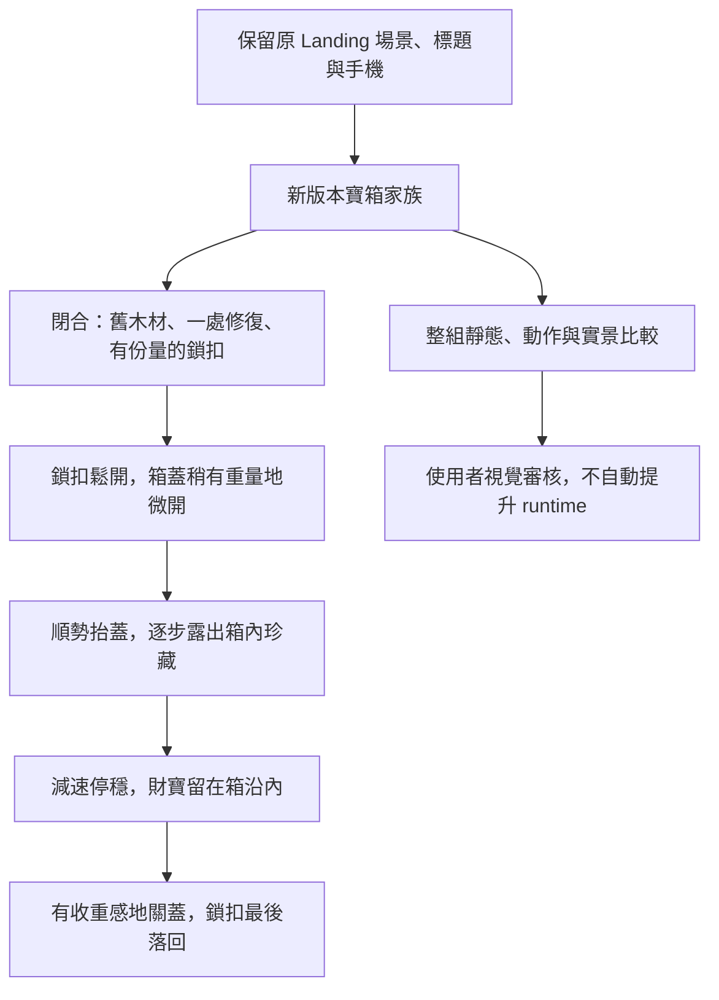

# Landing 藏寶箱修訂 — 小隊修整過的珍藏老箱

**日期：** 2026-10-19

**狀態：** 使用者已在對話確認外觀、動作與箱內方向；本文件待使用者核對。新修訂素材與播放尚未製作，也未獲視覺核准。

**範圍：** Phase 1 / Scenes / Landing，review-only。改進寶箱的故事感、開啟手感與財寶吸引力，不修改產品互動。

## 1. 整體關係與體驗順序

設計身份：**小隊把藏寶房留下的舊箱修整好，現在仍用它保管珍貴的戰利品。**

這是讓造型與動作一致的美術背景，不新增產品任務、故事文案、可讀文字、解謎或獎勵機制。

使用者希望三種感受同時成立：

1. 還沒打開，就覺得這只箱子有故事。
2. 開啟過程有實物的重量與手感。
3. 打開後的內容物誘人，值得湊近看。

保持 Landing「抵達有人陪伴的暖火休息處」的主情緒。寶箱是值得探索的次要物件，不能奪走篝火、Mimiku 與伙伴的主焦點。

## 2. 現有實作與本次修訂關係

沿用 [四態家族規格](2026-10-16-landing-treasure-chest-states-design.md)、
[材質規格](2026-10-15-landing-ordinary-chest-material-design.md) 及已確認標題位置；只有以下明列部分由本文修訂。

現有呼叫路徑是 `compose-treasure-chest-states.mjs` 的 `composeTreasureChestStates()`
讀取舊標題位置與材質 manifests，呼叫 `prepareFamily()` 及
`renderTreasureChestReview(m,parentHTML,scripts)`；後者嵌入已核對 hash 的原始 model/controller。
`mountChestStates()` 接 native buttons、圖片 decode 與 model；目前 model 的 `toggle()`
使用四態索引、固定每段140ms，關閉走反序。這是現有比較工具，不是產品 runtime。

現有來源定位（相對repo）：`docs/design/assets/reviews/2026-09-18-page-visual-phase-1/`
下的 `compose-treasure-chest-states.mjs:42`（入口）、`:100`（原始scripts）、
`render-treasure-chest-states.mjs:5`（renderer）、`treasure-chest-state.controller.mjs:1`（DOM接線）、
`treasure-chest-state.model.mjs:17`（toggle；固定140ms在第22／23行）。這些位置是現況，不代表已改成新節奏。

| 項目 | 保留 | 本次修訂 |
| --- | --- | --- |
| 物件身份 | 圓拱木蓋、鐵帶、鎖扣、原朝向／透視、非 Mimiku | 加入可辨認的修復與被照顧的年代感 |
| 常駐主狀態 | closed、cracked、half-open、open | 允許鎖扣與箱蓋必要過渡幀，不受原本四張來源限制 |
| 開關幀 | 同一只箱子、同一套材質與接地定位 | 開與關分別安排節奏，不能只是等速倒放 |
| 時間 | 手動啟動、可停止、reduced-motion | 固定140ms／總420ms不再是本次接受條件；改為有因果的非均勻節奏 |
| 內容物 | 金幣為主、少量寶石、全部留在箱內 | 高低堆疊、遮擋與深度；青藍寶石形成次要焦點 |
| 交付 | 透明來源、真實PNG、hash與provenance、整組比較 | 新增必要幀與開／關節奏紀錄，獨立版本保存 |

來源、定位、輸出、播放與 DOM controller 的責任仍分開。
後續計畫必須區分「主狀態 ID」與「過渡 frame ID」，以有序幀與逐段時間描述開、關序列，
不能讓新的素材張數偷偷改變按鈕語意或移動場景位置。

**特別取代的舊限制：**

- 原四張圖不是不可增加的硬上限；新增過渡幀不等於新增獎勵或常駐產品狀態。
- 不再要求每段相同140ms，亦不要求關閉是開啟時間的機械鏡像。
- 原規格只改箱蓋／內部的範圍，擴充到鎖扣的合理開合；箱身、箱腳與接地點仍固定。
- 舊家族的 HTML、PNG、manifest、來源、程式與 contracts 保留，不改寫歷史來適應新規則。
- 技術驗證已完成的 v01 圖稿依然未獲視覺核准。此次 OK 是修訂設計方向，不是 v01 圖稿或 Scenes family 的 approved。

## 3. 閉合外觀：使用中的珍藏老箱

### 舊木材

- 深暖棕色為主，保留圓拱蓋；大面積木板清楚、少量板片深淺差異，不拆成滿面碎紋。
- 箱沿、鎖扣附近等經常碰觸之處有局部磨亮；刮痕集中在合理接觸位置。
- 有年紀但完整、牢固且被照顧；不做腐爛、嚴重鏽蝕、裂到失去功能或戰損箱。

### 一處修復

- 一個下角曾換過包角鐵件；新舊鐵件色調、鉚釘可略有差異，但接合牢靠。
- 只用一處主要修復形成記憶點，不增加多處補丁、整面鉚釘或無法在實際尺寸辨認的微小裝飾。
- 不指定新的場景位置，也不為了顯示修復而改變寶箱朝向或透視。

### 鎖扣

- 普通、可理解的機械鎖具，輪廓與結構比目前通用方形鎖片更有份量。
- 其形狀須能支持後續鬆開、抬蓋與最後落回的動作，不是貼在箱面的紋飾。
- 不造成人臉、眼睛、牙齒或 Mimiku 表情，不加魔法機關、鑰匙任務或額外操作步驟。

像素顆粒繼續以戰士實際圖層與 master 為基準：深棕黑階梯輪廓、刻意像素群、
二至三階主要材質明暗、低彩度暖深灰鐵帶與節制破碎高光。
不加徽章、刻字、繩結或掛飾，不以模糊／平滑旋轉／噪點掩飾來源不一致。

## 4. 開啟與關閉：重量、因果、停穩

| 階段 | 視覺與節奏 | 必須避免 |
| --- | --- | --- |
| 鎖扣鬆開 | 點擊後先看見鎖扣動作，箱蓋才離開箱沿 | 蓋子穿過仍扣住的鎖扣、增加找鑰匙步驟 |
| 微開 | 箱蓋稍慢起步，縫隙露出少量箱內暖金色，短暫建立期待 | 故障、卡死、掙扎、獨立光源 |
| 抬蓋 | 接著順勢轉動，逐步顯露內蓋與珍藏；鉸鏈連接清楚 | 整只箱子位移、蓋子飛離、透視重畫 |
| 接近全開 | 減速並穩穩停住，有重量但不笨重 | 誇張回彈、橡皮彈性、箱身跳動 |
| 關閉 | 有收重感地回落，箱蓋合妥後鎖扣才落回 | 只是等速倒放、鎖扣提前穿入箱蓋、夾住財寶 |

四個主要狀態仍為 closed／cracked／half-open／open；必要過渡幀屬於同一家族，
含合理的鎖扣鬆開與箱蓋接近落定姿態。四個主狀態與新增幀須一起完成後審核，
不先交單張要求核准，不分別重設計四只箱子。

逐幀時間、所需總張數與開／關序列由實作計畫具體拆解；依據是本節的動作因果與視覺可讀性，
不是沿用舊140ms或事先追求大量幀數。計畫需保存可重現的序列／時間資料並測試，
不得用 CSS 旋轉閉合稿冒充新像素幀。

本輪純視覺，不加音效、自動循環、待機呼吸、相機抖動、粒子、獎勵或金錢／帳務行為。
手動開關與逐態／逐幀檢視保留；播放中重複點擊不排隊，手動選幀取消播放。
reduced-motion 直接切到目標終態，仍可逐幀查看；缺圖或解碼失敗明示錯誤並停止播放，
不拿舊圖假裝新幀載入成功。增加過渡幀不能破壞這些既有操作與失敗保護。

## 5. 箱內：深度與逐步揭露

- 金幣分成高低不同、相互重疊的小堆；部分藏在箱沿與暗處後方，不像整齊排列的商品。
- 讓內容物與箱內木材的前後遮擋產生深度，不把財寶填到超過箱沿，也不改成空箱。
- 少量寶石集中形成一個次要焦點，以一顆青藍色寶石點綴暖金色；不平均鋪滿高飽和彩虹色。
- 內蓋與箱內木材較暗，只有部分金幣邊緣與寶石切面接到現有火光。誘人來自明暗反差與逐步露出，
  不是把整箱調亮、自體發光、連續閃爍或巨大光柱。
- 所有財寶始終留在箱內；不噴出、不掉落、不增加地面財寶。
- 不新增卷軸、藥瓶、布包或其他道具，不畫金額、幣別、金融符號、文字或數字。

## 6. 定位與歷史保護

桌機維持960×540 logical pixels；閉合基準圖層為(105,284)、78×66，
共同ground anchor為(144,350)。以目前104×120共同透明包絡、scene origin(92,230)、
local ground(52,120)作新版本規劃基準，不藉逐幀縮放、裁緊再fit、箱身平移來容納開蓋。
若新鎖扣或過渡幀無法在既有包絡內成立，先回報具體衝突，不自行放大、移位或搬動其他物件。

桌機標題仍為(376,100)、288×84；手機標題仍為(130,59)、148×98。
手機390×600整張PNG bytes保留。其餘人物、篝火、地圖木箱、陷阱、通道、背景與live UI不動。
所有差異只可位於寶箱的活動包絡；必須獨立驗證場景重組與包絡外pixels一致。

review根目錄：`docs/design/assets/reviews/2026-09-18-page-visual-phase-1/`。
以下現有v01僅為延伸參照，不是已核准美術；新來源、圖層、頁面、manifest及必要播放模組另存版本。

| 基準（相對review根目錄） | SHA-256 |
| --- | --- |
| `treasure-chest-states.manifest.json` | `61f1bf4e2ec7efca3e3c80a08af1852f674868094d8912962d2c40082c636cb1` |
| `samples/derivations/treasure-chest-states-v01/family-source.png` | `a666381ea471a8670f3bcff8b0acf534a0bc2a3e969a264b03219af0233100ce` |
| `samples/treasure-chest-states-v01/closed-sprite.png` | `46675fe65150e2a80df60f0bde3f014a5e175e9eb382128656d54ac087a95116` |
| `samples/treasure-chest-states-v01/cracked-sprite.png` | `ba5d88e15a886552ffc84e31821d40828591b89c977b5a5f3428fe3016a2fc20` |
| `samples/treasure-chest-states-v01/half-open-sprite.png` | `e603fcd4978e3b8240367589d8061418b295ac36e177f68614d8c92886cc74be` |
| `samples/treasure-chest-states-v01/open-sprite.png` | `a79d5c8604180644a8d8a666f3c769aeebdb6dce711aff292fbe66f102e35a17` |

## 7. 後續製作與審核要求

所有創意來源、鎖扣與箱蓋過渡幀均使用ImageGen生成／修訂；製作前逐張view_image檢查
現有家族、戰士master／實際圖層與場景。保留實際prompts、edit targets、references、每次生成來源hash與版本關係。
程序只負責透明整理、共同定位、nearest輸出及合成，不繪製新的修復零件、箱蓋或財寶。

新review同頁提供：

- 四個主狀態與所有必要過渡幀的實際大小、相同整數倍率與真實灰階PNG。
- 目前v01原家族及戰士參照，明確區分原稿、新稿與過渡幀，不把過渡幀當新的設計候選。
- 固定桌機場景的逐態、逐幀與開／關預覽，未變動的手機版本。
- 可讀frame/state標籤、來源、尺寸、anchors、exact hashes及開／關節奏資料。
- native buttons與固定箱身hit target；鍵盤、觸控、focus、reduced-motion與載入失敗回饋。

接受條件包括：閉合時可辨認的一處修復與可靠鎖扣；開關具有動作因果、重量與停穩；
財寶逐步揭露且有深度；所有幀箱身穩定、無裁切與不合理接縫；實際場景大小與戰士顆粒一致。
不可只憑放大圖、額外亮度或測試通過判定美術核准。

後續實作計畫明列TDD、focused Vitest、ESLint、typecheck、320／390／768／1440 Playwright、
開／關序列與時間測試、手動中斷／重複操作、reduced-motion、缺檔與不可解碼、determinism、
透明RGB／alpha／尺寸、anchor與包絡外pixel驗證；保留舊contracts，不為新節奏改寫歷史驗證。
會暫時修改自有manifest的測試須隔離或循序執行，避免不同套件互讀故意損壞的中間狀態。
實作後self-review、verification-before-completion與devlog append，提供實測證據後停在整組視覺checkpoint。

## 8. 交付單位與停止點

| 單位 | 分支／範圍 | 依賴與停止點 | 建議commit message |
| --- | --- | --- | --- |
| 修訂規格（本輪） | 沿用checkout，僅新增本文 | 使用者核對本文後，才撰寫實作計畫 | `docs(visual): define restored treasure chest refinement` |
| 修訂實作計畫（下一輪） | 沿用checkout，新計畫文件 | 交付完整素材／播放／驗證拆解後暫停 | `docs(visual): plan restored treasure chest refinement` |
| 新版本整組製作（計畫核准後） | 新版本來源、review pipeline、頁面、tests與devlog增量 | 全組完成後等待視覺審核，不先核准單張 | `feat(visual): refine restored treasure chest review` |

不建worktree、不派遣subagent、不再詢問Inline或Subagent模式。
保留既有dirty/staged/untracked工作，不觸碰或暫存`.codex-remote-attachments/`與`reference/`，不使用`git add .`。
依新版協作約定，由使用者review並手動commit；agent不自行stage、commit、push或建立PR。

本輪只寫本文，不生成圖、不修改程式或舊審核頁。後續即使視覺核准，也不自動授權runtime安裝。
不改`web/public`、asset registry、PWA manifest、service worker、產品頁面、Home或帳務，
不做production exports、不推進Phase 2。新artifacts維持`awaiting-calibration`、`reviewOnly: true`、`runtimePromotion: false`。
